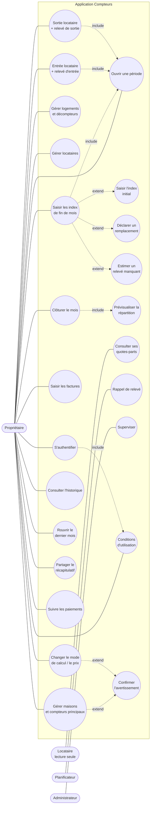
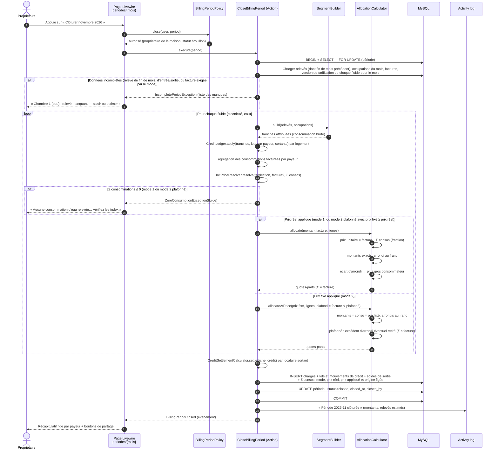
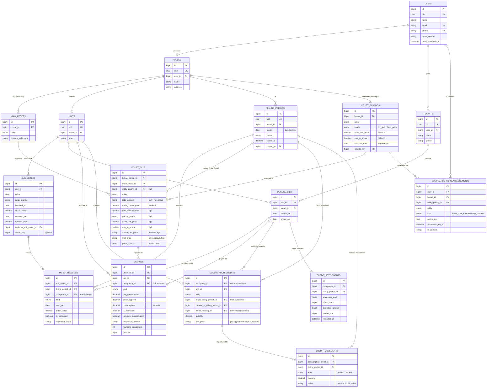

# CONCEPTION — application « Compteurs »

> Dossier de conception fonctionnelle et technique, rédigé le 2026-11-07.
> Stack de référence : [`STACK.md`](STACK.md) (Laravel 13, Livewire 4, Filament 5, MySQL 8, Hostinger).
> Aucune ligne de code n'est écrite à ce stade.
>
> **Révision 2 (2026-11-07)** : intègre les réponses du propriétaire (méthode de calcul unique,
> entrées/sorties en cours de mois, logement vacant, factures mensuelles, estimation des relevés
> manquants). Les décisions prises sont listées en section 8.1 ; les hypothèses restantes,
> marquées **[H-n]**, en section 8.2.
>
> **Révision 3 (2026-11-07)** : H-14 et H-15 validées ; surestimation traitée par un **crédit de
> consommation** sur le décompteur (plus aucun montant négatif) ; arrondi standard.
>
> **Révision 4 (2026-11-07)** : le crédit appartient au **locataire**, pas au décompteur ; il ne
> passe jamais au locataire suivant et il est **soldé en FCFA à la sortie** (déduction sur la
> dernière fiche, reste « à rembourser au locataire »).
>
> **Révision 5 (2026-11-07)** : H-20 à H-22 validées (D-13 à D-15) ; cas rares tranchés selon la
> règle de travail de la section 8.2 (H-23 à H-29). Dossier de conception **finalisé**.
>
> **Révision 6 (2026-11-08)** : **deux modes de calcul**, au choix du propriétaire, par maison et
> par fluide — mode 1 « répartition de la facture » (par défaut, inchangé) et mode 2 « prix fixé
> par le propriétaire », plafonné ou non au prix réel ; historique des prix avec date d'effet ;
> avertissement de conformité SBEE / SONEB confirmé et tracé ; vocabulaire « répartition des
> charges » / « participation aux frais » ; conditions d'utilisation acceptées à l'inscription
> (D-16 à D-22, H-31 à H-38). H-30 et H-33 validées le 2026-11-08 (D-23, D-24).

---

## 0. Contexte et vocabulaire

Au Bénin, un **propriétaire** possède une ou plusieurs **maisons**. Chaque maison a un
**compteur principal** d'électricité (SBEE) et un compteur principal d'eau (SONEB), facturés
**chaque mois**. Chaque **logement** loué a son propre **décompteur** d'électricité et d'eau. En fin
de mois, le propriétaire relève les décompteurs, saisit le montant total de chaque facture, et
l'application calcule la **participation de chaque locataire aux frais d'eau et d'électricité**
(répartition des charges), selon le **mode de calcul** choisi pour la maison et le fluide.

> **Vocabulaire imposé** (ENF-15) : l'interface, les messages, les emails et les fiches PDF
> parlent de « répartition des charges » et de « participation aux frais d'eau / d'électricité »,
> **jamais** de « vente », « achat », « revente », « vendre » ou « acheter ». Seul le texte de
> l'avertissement de conformité (EF-48) et les conditions d'utilisation citent la revente, pour
> l'interdire.

| Terme | Définition |
|---|---|
| Maison | Bâtiment ou concession appartenant à un propriétaire. Porte 1 compteur principal par fluide. |
| Fluide | `électricité` (kWh) ou `eau` (m³). |
| Compteur principal | Compteur du fournisseur (SBEE ou SONEB) pour toute la maison. Sa consommation n'intervient **pas** dans le calcul. |
| Logement | Chambre, appartement ou boutique dans la maison. Équipé d'un décompteur par fluide. |
| Décompteur | Sous-compteur privé d'un logement. Peut être remplacé (on garde l'historique). |
| Occupation | Période pendant laquelle un locataire occupe un logement (date d'entrée, date de sortie). |
| Période | Un mois d'une maison (ex. `2026-10`). Statut **brouillon** puis **clôturée**. |
| Relevé | Index lu (ou estimé) sur un décompteur à une date. Types : **initial**, **pose**, **entrée**, **sortie**, **fin de mois**, **dépose**. |
| Tranche | Consommation entre deux relevés consécutifs d'un même décompteur, attribuée à un seul payeur (un locataire ou le propriétaire). |
| Facture | Pour une période et un fluide : montant total TTC (FCFA), consommation du compteur principal facultative. Obligatoire en mode 1 et en mode 2 plafonné ; facultative en mode 2 non plafonné. |
| Mode de calcul | Choisi par maison **et** par fluide, avec date d'effet : **mode 1** « répartition de la facture » (par défaut) ou **mode 2** « prix fixé par le propriétaire ». |
| Prix réel | `montant total de la facture ÷ somme des consommations de tous les décompteurs` du fluide sur la période (locataires et propriétaire / vacant). Fraction exacte. |
| Prix fixé | Mode 2 : prix saisi par le propriétaire, en FCFA par kWh ou par m³ (2 décimales au plus). |
| Plafond au prix réel | Option du mode 2, **activée par défaut** : le prix appliqué ne dépasse jamais le prix réel. |
| Prix appliqué | Prix qui sert au calcul des participations du mois : mode 1 → prix réel ; mode 2 plafonné → `min(prix fixé, prix réel)` ; mode 2 non plafonné → prix fixé. Figé à la clôture ; c'est aussi le prix des lots de crédit (« prix unitaire » dans la suite du document). |
| Quote-part / participation | Montant dû par un payeur pour un fluide et une période (« participation aux frais d'électricité »). |
| Écart d'encaissement | Mode 2, *information seulement* : Σ des participations des locataires − montant de la facture, affiché quand la facture est saisie. |
| Propriétaire / vacant | Payeur des tranches où le logement n'est occupé par personne. |
| Relevé estimé | Index de fin de mois calculé à partir de la moyenne des 3 derniers mois quand le relevé réel manque. |
| Régularisation | Correction automatique d'une estimation au relevé réel suivant : la tranche part de l'index estimé. |
| Crédit de consommation | Quantité (kWh ou m³) due **au locataire** qui a payé une surestimation (index estimé − index réel), valorisée au **prix appliqué** du mois surestimé (quel que soit le mode). Déduite de ses consommations suivantes sur le même logement et le même fluide, sans jamais les rendre négatives ; soldée en FCFA à sa sortie. |
| Solde de crédit | À la sortie : crédit restant converti en FCFA, déduit de la dernière fiche du locataire ; l'excédent est « à rembourser au locataire ». |
| Consommation brute / facturée | Brute : `index de fin − index de début`. Facturée : brute ramenée à 0 si négative, moins le crédit imputé. |
| Écart d'arrondi | Différence entre le montant de la facture et la somme des quotes-parts arrondies au franc (quand le prix réel est appliqué). |
| Écart de comptage | *Information seulement* : consommation du compteur principal − somme des décompteurs, affichée si la consommation principale est saisie. |

---

## 1. Acteurs et cas d'utilisation

### 1.1 Acteurs

| Acteur | Description | Accès |
|---|---|---|
| **Propriétaire** | Gère ses maisons, logements, locataires, saisit les relevés et factures, clôture les mois. | Compte (email ou téléphone + mot de passe, via Fortify). Voit uniquement ses propres données. |
| **Locataire** (lot 3) | Consulte ses quotes-parts et l'historique de ses relevés. | **Lecture seule**, par lien personnel signé (pas de compte) **[H-1]**. |
| **Administrateur** | Équipe technique : support, supervision. | Panel Filament `/admin`. |
| Système (planificateur) | Rappel de relevé en fin de mois, sauvegardes. | Cron Hostinger `schedule:run`. |

### 1.2 Cas d'utilisation

| Code | Cas d'utilisation | Acteur | Lot |
|---|---|---|---|
| UC-01 | S'inscrire (avec **acceptation des conditions d'utilisation**), se connecter, réinitialiser son mot de passe | Propriétaire | MVP |
| UC-02 | Gérer ses maisons (créer, modifier, archiver), leurs compteurs principaux et **le mode de calcul de chaque fluide** | Propriétaire | MVP |
| UC-03 | Gérer les logements et leurs décompteurs | Propriétaire | MVP |
| UC-04 | Gérer les locataires | Propriétaire | MVP |
| UC-05 | Enregistrer l'entrée d'un locataire, avec **relevé d'entrée** | Propriétaire | MVP |
| UC-06 | Enregistrer la sortie d'un locataire, avec **relevé de sortie** | Propriétaire | MVP |
| UC-07 | Ouvrir une période (mois) | Propriétaire | MVP |
| UC-08 | Saisir les index de fin de mois | Propriétaire | MVP |
| UC-09 | Saisir l'index initial (premier mois, décompteur sans historique) | Propriétaire | MVP |
| UC-10 | Déclarer un remplacement de décompteur | Propriétaire | MVP |
| UC-11 | Estimer un relevé de fin de mois manquant | Propriétaire | MVP |
| UC-12 | Saisir le montant total des factures (et, facultativement, la consommation principale) | Propriétaire | MVP |
| UC-13 | Prévisualiser la répartition | Propriétaire | MVP |
| UC-14 | Clôturer le mois (figer les montants) | Propriétaire | MVP |
| UC-15 | Consulter l'historique des mois clôturés | Propriétaire | MVP |
| UC-16 | Rouvrir le dernier mois clôturé (correction) | Propriétaire | Lot 2 |
| UC-17 | Partager le récapitulatif d'un locataire (WhatsApp, SMS, fiche PDF) | Propriétaire | Lot 2 |
| UC-18 | Enregistrer les paiements reçus et suivre les impayés | Propriétaire | Lot 2 |
| UC-19 | Consulter ses quotes-parts et relevés | Locataire | Lot 3 |
| UC-20 | Être rappelé de relever les compteurs en fin de mois | Système → Propriétaire | Lot 3 |
| UC-21 | Superviser les comptes et l'application | Administrateur | MVP (Filament de base) |
| UC-22 | Changer le mode de calcul, le prix fixé ou le plafond d'un fluide (avec date d'effet et, si besoin, **confirmation de l'avertissement de conformité**) | Propriétaire | MVP |
| UC-23 | Consulter les conditions d'utilisation | Tout visiteur | MVP |

---

## 2. Exigences

### 2.1 Exigences fonctionnelles

#### Maisons, compteurs, logements

- **EF-01** — Un propriétaire peut créer plusieurs maisons (nom, quartier/ville, repère). À la
  création, il choisit le **mode de calcul** de l'électricité et celui de l'eau (mode 1 proposé
  par défaut), voir EF-39.
- **EF-02** — Une maison a **exactement un** compteur principal d'électricité et **exactement un**
  compteur principal d'eau, avec leur référence fournisseur (n° compteur SBEE, n° de police SONEB).
- **EF-03** — Une maison contient un ou plusieurs logements (libellé unique dans la maison :
  « Chambre 1 », « Boutique »…).
- **EF-04** — Chaque logement a au plus **un décompteur actif par fluide**. Un décompteur porte un
  numéro de série (facultatif), une date de pose et un index de pose.
- **EF-05** — Un logement sans décompteur pour un fluide ne participe pas à la répartition de ce
  fluide (sa consommation est de fait payée par les autres, au prorata).

#### Locataires, occupations, entrées et sorties

- **EF-06** — Un propriétaire gère ses locataires (nom, téléphone au format béninois +229).
- **EF-07** — Une occupation relie un locataire à un logement avec une date d'entrée et une date de
  sortie facultative. Un logement a **au plus une occupation en cours** à une date donnée.
- **EF-08** — Enregistrer une **entrée** exige un **relevé d'entrée** (index et date) pour chaque
  décompteur actif du logement. Enregistrer une **sortie** exige un **relevé de sortie**. Si
  l'entrée ou la sortie tombe le jour d'un relevé de fin de mois, l'index est pré-rempli avec
  celui-ci.
- **EF-09** — La consommation de chaque occupant est calculée avec **ses propres index** : du
  relevé d'entrée (ou du dernier relevé de fin de mois) jusqu'au relevé de sortie (ou au relevé de
  fin de mois). Il n'y a **aucun prorata au nombre de jours** pour les relevés réels.
- **EF-10** — La consommation d'un logement **sans occupant** (entre une sortie et l'entrée
  suivante, ou tout le mois) est à la charge du propriétaire, sur la ligne
  **« Propriétaire / vacant »**.
- **EF-11** — Attribution d'une tranche (relevé `a` → relevé `b`, même décompteur) :
  1. si `b` est un relevé de **sortie** → l'occupant qui sort ;
  2. sinon, si `a` est un relevé d'**entrée** → l'occupant qui entre ;
  3. sinon, si `a` est un relevé de **sortie** ou si `b` est un relevé d'**entrée** →
     propriétaire / vacant (le logement était vide avant l'entrée) ;
  4. sinon → l'occupant en place à la date de `b`, ou propriétaire / vacant s'il n'y en a pas.

  Les relevés d'un décompteur sont ordonnés par date puis par type
  (initial/pose < sortie < entrée < dépose < fin de mois).
- **EF-12** — Le relevé de sortie ou d'entrée est rattaché à la période du mois de sa date ; la
  période est ouverte automatiquement si besoin. Le locataire sortant connaît son montant à la
  clôture du mois (la facture du mois n'est pas connue avant).

#### Saisie mensuelle

- **EF-13** — Le propriétaire ouvre une période par maison et par mois. Une seule période par
  maison et par mois.
- **EF-14** — Pour chaque décompteur actif, le point de départ du mois est repris automatiquement du
  relevé de fin de mois précédent (réel ou estimé).
- **EF-15** — S'il n'existe aucun relevé antérieur (premier mois, nouveau décompteur), un **relevé
  initial** est **saisi manuellement** (pré-rempli avec l'index de pose s'il est connu).
- **EF-16** — `consommation brute d'une tranche = index de fin − index de début` ; la
  consommation facturée en découle selon EF-24 (crédit).
- **EF-17** — Un index **inférieur** au relevé précédent est **refusé** avec le message
  « L'index saisi (…) est inférieur à l'index précédent (…). Si le décompteur a été changé,
  déclarez un remplacement. » **Seule exception** : le relevé précédent est **estimé** ; l'index
  réel est alors accepté s'il reste supérieur ou égal au **dernier index réel** du décompteur, et
  la différence devient un crédit (EF-24).
- **EF-18** — Déclaration d'un **remplacement de décompteur** : le propriétaire saisit l'index de
  dépose de l'ancien, la date, et l'index de pose du nouveau. Pour la période, la consommation du
  logement = (index de dépose − index précédent de l'ancien) + (index de fin de mois du nouveau −
  index de pose du nouveau). Le même mécanisme couvre un compteur **remis à zéro** ou qui « fait
  le tour ».
- **EF-19** — Pour chaque fluide, le propriétaire saisit **chaque mois** le **montant total de la
  facture** (FCFA, entier, **TTC : abonnement, redevances et taxes inclus**). En mode 1, ce montant
  est réparti entièrement selon la consommation, **sans part fixe**. La saisie est **obligatoire**
  en mode 1 et en mode 2 plafonné, **facultative** en mode 2 non plafonné (EF-43).
- **EF-20** — La **consommation du compteur principal** est un champ **facultatif**, à titre
  d'information. Si elle est saisie, l'écran affiche l'écart de comptage (en unité et en %),
  sans alerte bloquante ni confirmation. Elle n'intervient **jamais** dans le calcul.
- **EF-21** — La saisie est enregistrée **au fil de l'eau** (brouillon) : le propriétaire peut
  quitter et reprendre plus tard sans rien perdre.

#### Relevé manquant : estimation et régularisation

- **EF-22** — Si le relevé de fin de mois d'un décompteur ne peut pas être fait, le propriétaire
  demande une **estimation** : index estimé = dernier index connu du mois + moyenne des
  consommations des **3 dernières périodes clôturées** du logement pour ce fluide. Si le dernier
  index connu date d'une entrée en cours de mois, la moyenne est ramenée au nombre de jours restants
  **[D-7]**. Résultat arrondi au millième (0,0005 vers le haut).
- **EF-23** — Le relevé estimé est marqué **« estimée »** : badge à l'écran de saisie, sur le
  récapitulatif, dans l'historique et sur la **fiche PDF** du locataire (lot 2), avec la base de
  calcul (« moyenne de 150, 134 et 142 kWh »).
- **EF-24** — Régularisation et **crédit de consommation** :
  - **a.** Le mois suivant, la tranche part de l'**index estimé** : la consommation devient
    `index réel − index estimé`, ce qui **régularise automatiquement** l'estimation grâce à
    l'index cumulatif. La ligne porte la mention « régularisation ».
  - **b.** Si l'index réel est **inférieur** à l'index estimé, la consommation de la tranche est
    **ramenée à 0** et la différence `index estimé − index réel` devient un **lot de crédit** :
    - qui appartient au **payeur de la tranche estimée** (le locataire qui a payé la
      surestimation) ;
    - valorisé au **prix appliqué du mois surestimé** (celui du relevé estimé), conservé en
      fraction exacte **[D-14]** : prix réel en mode 1, `min(prix fixé, prix réel)` en mode 2
      plafonné, prix fixé en mode 2 non plafonné **[D-20]**. Le lot garde ce prix même si le
      mode ou le prix change ensuite.
  - **c.** Le crédit d'un locataire est **déduit** uniquement de **ses propres tranches**, sur le
    même logement et le même fluide, dans l'ordre chronologique, **sans jamais rendre une
    consommation négative** : `imputé = min(crédit restant, consommation brute)`. Les lots sont
    consommés du plus ancien au plus récent. Le crédit s'impute aussi sur une consommation
    estimée. Il **ne profite jamais** à un autre locataire ni à la ligne propriétaire / vacant.
  - **d.** Le crédit restant est affiché sur la carte du décompteur à l'écran de saisie (avec le
    nom du locataire), sur le récapitulatif et sur la **fiche PDF** (« Crédit restant : 82 kWh »),
    ainsi que le crédit imputé sur la ligne du payeur (« dont 14 kWh de crédit déduit »).
  - **e.** Le crédit étant attaché au locataire (et non au décompteur), un **remplacement de
    décompteur** ne change rien : il s'impute sur les tranches du nouveau décompteur (D-12).
  - **f.** **Sortie d'un locataire** qui a encore du crédit, à la clôture du mois de sortie, après
    imputation normale sur les tranches de ce mois :
    1. chaque lot restant est converti en FCFA à **son** prix unitaire ; la valeur totale
       (électricité + eau) est arrondie **une seule fois** au franc **[D-15]** ;
    2. ce montant est **déduit de sa dernière fiche** (total électricité + eau du mois de sortie) ;
    3. s'il dépasse le montant de cette fiche, la fiche est ramenée à 0 et le reste apparaît comme
       **« À rembourser au locataire : … FCFA »** sur la fiche PDF et dans le suivi des paiements ;
    4. le crédit est **soldé** (mouvement `settled`) et ne passe jamais au locataire suivant.
  - **g.** La déduction est une **charge du propriétaire** (il avait encaissé la surestimation) :
    elle n'entre pas dans le calcul des participations du mois (en mode 1, leur somme reste
    exactement égale au montant de la facture). Le récapitulatif de la maison l'affiche sur une ligne
    « Propriétaire — remboursement de crédit ».
  - **h.** Si la tranche surestimée était au propriétaire / vacant, le crédit appartient au
    propriétaire et ne s'impute que sur les tranches vacantes suivantes du même logement **[D-13]**.
  - **i.** Aucune quote-part n'est jamais négative : il n'y a pas d'avoir.
- **EF-25** — Moins de 3 périodes clôturées : moyenne des périodes disponibles. Aucune : estimation
  impossible, message « Pas d'historique pour estimer ce décompteur : saisissez l'index réel. »
  **[D-8]**.

#### Calcul

- **EF-26** — **Mode 1 « répartition de la facture »** (mode par défaut, D-1) :
  - `consommation du payeur = Σ des consommations facturées de ses tranches` (index nouveau −
    index ancien, après crédit, EF-24) ;
  - `prix unitaire = prix réel = montant total de la facture ÷ Σ des consommations de tous les
    payeurs` (locataires et propriétaire / vacant) ;
  - `montant du payeur = sa consommation × prix unitaire`.

  Le mode 2 (prix fixé) est décrit en EF-39 à EF-47 ; la consommation de chaque payeur
  (tranches, estimation, crédit) se calcule de la même façon dans les deux modes : seul le prix
  change.
- **EF-27** — Les prix (réel, fixé, appliqué) sont conservés sous forme de **fraction exacte** ;
  aucun calcul en flottant. Ils sont affichés arrondis à 3 décimales.
- **EF-28** — Arrondi de chaque montant **au franc CFA le plus proche** (0,5 arrondi vers le
  haut). Les montants sont toujours positifs ou nuls.
- **EF-29** — Quand le **prix réel** est appliqué (mode 1, ou mode 2 plafonné dont le plafond
  joue), l'**écart d'arrondi** (facture − Σ montants arrondis) est ajouté au montant du **plus
  gros consommateur** du fluide (y compris la ligne propriétaire / vacant). En cas d'égalité, au
  logement de plus petit libellé (ordre alphabétique naturel : « Chambre 2 » avant « Chambre 10 »),
  puis à l'occupant entré le premier **[H-5]**. Si un ajustement négatif rendait ce montant
  négatif (facture de quelques francs seulement), le reliquat passe au consommateur suivant. Ainsi,
  **Σ quotes-parts = montant de la facture**, exactement.
- **EF-30** — L'application calcule en direct, à chaque saisie, les quotes-parts par payeur et par
  fluide, et le total à payer par locataire (électricité + eau).

#### Clôture et historique

- **EF-31** — La **clôture** n'est possible que si :
  1. chaque décompteur actif a un relevé de fin de mois (réel ou estimé) ;
  2. chaque entrée et sortie du mois a ses relevés ;
  3. la facture de chaque fluide est saisie lorsque son mode l'exige (mode 1 et mode 2
     plafonné ; EF-19) ;
  4. pour chaque fluide en **mode 1** ou en **mode 2 plafonné**, **Σ consommations > 0**. Sinon,
     clôture **bloquée** avec le message : « Aucune consommation d'eau relevée en novembre 2026
     (somme des décompteurs = 0 m³). La facture de 3 500 FCFA ne peut pas être répartie :
     vérifiez les index saisis. » En **mode 2 non plafonné**, une somme nulle est acceptée :
     toutes les participations valent 0 (EF-44).
- **EF-32** — À la clôture, les quotes-parts sont **figées** en base (consommations brutes et
  facturées, crédit créé et imputé, **mode de calcul, prix fixé, plafond, prix réel, prix
  appliqué et son origine**, montants, mentions « estimée » / « régularisation »). La période
  passe en statut `clôturée` et n'est plus modifiable.
- **EF-33** — Le propriétaire consulte l'historique par maison, par mois et par locataire.
- **EF-34** — (Lot 2) Le propriétaire peut **rouvrir uniquement la dernière période clôturée**
  d'une maison, avec un motif obligatoire, tant que la période suivante n'a aucun relevé saisi.
- **EF-35** — Toute création, modification, estimation, clôture et réouverture est tracée
  (journal d'activité).

#### Restitution

- **EF-36** — Récapitulatif par locataire, intitulé « Participation aux frais d'eau et
  d'électricité » : logement, dates d'occupation dans le mois, index de
  début et de fin de chaque tranche, consommation, crédit déduit, crédit restant, **prix
  appliqué et son origine** (EF-42), montant par fluide, total ; mentions « estimée » et « régularisation » ; sur la fiche de sortie :
  « Crédit restant remboursé : … FCFA », net à payer et, le cas échéant, « À rembourser au
  locataire : … FCFA ». Ligne « Propriétaire / vacant » sur le récapitulatif
  de la maison.
- **EF-37** — (Lot 2) Partage du récapitulatif en un clic par WhatsApp/SMS (texte court) et en
  fiche PDF.
- **EF-38** — (Lot 3) Lien personnel signé, révocable, donnant au locataire la lecture seule de ses
  propres récapitulatifs.

#### Mode de calcul (révision 6)

- **EF-39** — Le mode de calcul est choisi **par maison et par fluide** : l'électricité et l'eau
  d'une même maison peuvent avoir des modes différents. À la création de la maison, le formulaire
  propose le **mode 1** pour les deux fluides ; le propriétaire peut le changer ensuite dans les
  paramètres de la maison (UC-22).
- **EF-40** — **Mode 2 « prix fixé par le propriétaire »** : le propriétaire saisit un prix en
  FCFA par kWh (électricité) et/ou par m³ (eau), strictement positif, avec 2 décimales au plus
  (« 127,50 ») **[H-37]**. Pour chaque payeur :
  `montant = consommation facturée × prix appliqué`, arrondi au franc (EF-28). L'option
  **« Plafonner au prix réel »** est **activée par défaut**.
- **EF-41** — **Mode 2 plafonné** : la facture du mois est **obligatoire** et
  `prix appliqué = min(prix fixé, prix réel)`.
  - Si `prix fixé ≥ prix réel`, le prix réel s'applique et le calcul est **exactement celui du
    mode 1**, écart d'arrondi compris (EF-29) : Σ participations = facture **[D-23]**.
  - Si `prix fixé < prix réel`, le prix fixé s'applique : chaque montant est arrondi séparément,
    sans écart d'arrondi. Si, par le seul effet des arrondis, Σ des montants dépassait la
    facture, l'excédent serait retiré selon la règle d'attribution d'EF-29 : le plafond tient au
    franc près **[H-31]**. Le reste `facture − Σ participations` est affiché « Reste à la charge
    du propriétaire ».
- **EF-42** — L'écran de résultat, le récapitulatif et la fiche PDF indiquent **quel prix a été
  appliqué** et pourquoi :
  - « Prix appliqué : 127,50 FCFA/kWh — prix fixé (prix réel : 136,385) » ;
  - « Prix appliqué : 136,385 FCFA/kWh — prix réel, inférieur au prix fixé de 150,00 » ;
  - « Prix appliqué : 150,00 FCFA/kWh — prix fixé, sans plafond » ;
  - mode 1 : « Prix unitaire : 136,385 FCFA/kWh — répartition de la facture ».
- **EF-43** — **Mode 2 non plafonné** : la facture est **facultative**. Si elle est saisie,
  l'écran affiche l'**écart d'encaissement** = Σ des participations des locataires − montant de
  la facture, en FCFA et en %, **à titre d'information seulement** (aucune alerte bloquante,
  aucune confirmation, aucun effet sur le calcul). Sans facture : « Facture non renseignée ».
- **EF-44** — En mode 2 non plafonné, une somme de consommations nulle n'empêche pas la clôture :
  toutes les participations du fluide valent 0.
- **EF-45** — En mode 2, la ligne **« Propriétaire / vacant »** est calculée comme les autres
  (consommation × prix appliqué) et présentée comme la part du propriétaire ; elle n'entre pas
  dans le total des participations des locataires ni dans l'écart d'encaissement **[H-32]**.
- **EF-46** — **Historique des prix avec date d'effet** :
  - chaque changement de mode, de prix fixé ou de plafond crée une **version de tarification**
    `(maison, fluide)` avec un **mois d'effet** (1er du mois) ; les versions ne sont jamais
    supprimées ;
  - une période utilise la version la plus récente dont le mois d'effet est ≤ son mois ; une
    période antérieure à la première version utilise la première **[D-24]** ; la date d'effet est toujours un mois entier ;
  - le mois d'effet doit être **postérieur à la dernière période clôturée** de la maison ; il vaut
    par défaut le **premier mois non clôturé** et le propriétaire peut choisir un mois plus
    lointain. Message de refus : « Février 2027 est clôturé : le nouveau prix peut s'appliquer au
    plus tôt à mars 2027. » ;
  - une version qu'aucune période clôturée n'utilise peut être corrigée sur place (même mois
    d'effet) ; une version déjà utilisée par une clôture est **immuable** **[H-34]** ;
  - les brouillons concernés sont recalculés immédiatement ; les périodes clôturées gardent leurs
    montants (ENF-08).
- **EF-47** — Les crédits de consommation fonctionnent à l'identique dans les deux modes (EF-24) :
  ils s'imputent en quantité et sont valorisés, au solde de sortie, au **prix appliqué du mois
  surestimé**, même si le mode ou le prix a changé depuis (D-20).

#### Conformité (révision 6)

- **EF-48** — **Avertissement de conformité.** À l'**activation du mode 2** (à la création de la
  maison ou en quittant le mode 1) et à **chaque désactivation du plafond**, une fenêtre affiche
  le texte suivant, que le propriétaire doit confirmer (« J'ai lu et je confirme ») avant que le
  changement soit enregistré :

  > « Les règlements de service de la SBEE (art. 90) et de la SONEB interdisent à l'abonné de
  > revendre ou céder l'eau et l'électricité à des tiers. Vous restez seul responsable du respect
  > de vos contrats. »

  Sans confirmation, rien n'est enregistré. L'avertissement n'est **pas** demandé pour un simple
  changement de prix en mode 2, pour la réactivation du plafond ni pour le retour au mode 1. Si
  les deux événements ont lieu en même temps (mode 2 créé sans plafond), l'avertissement est
  affiché une fois et deux confirmations sont enregistrées **[H-35]**.
- **EF-49** — Chaque confirmation est **enregistrée** : utilisateur, date et heure, maison,
  fluide, version de tarification concernée, événement (activation du mode 2 / désactivation du
  plafond), texte exact affiché et adresse IP. Les confirmations ne sont ni modifiables ni
  supprimables (même si la maison est archivée) ; le propriétaire les voit dans les paramètres de
  la maison, l'administrateur dans Filament.
- **EF-50** — **Vocabulaire** : « répartition des charges », « participation aux frais d'eau /
  d'électricité », jamais « vente » ni « achat » (ENF-15).
- **EF-51** — **Conditions d'utilisation** : page publique `/conditions-utilisation`, qui précise
  notamment que l'application est un outil de répartition des charges et que **le propriétaire
  reste seul responsable du respect de ses contrats SBEE et SONEB**. L'inscription exige de cocher
  « J'accepte les conditions d'utilisation » (case non pré-cochée, lien vers la page) ; la version
  acceptée et la date sont enregistrées. Si une nouvelle version est publiée, elle doit être
  acceptée à la connexion suivante avant tout accès **[H-36]**.

### 2.2 Exigences non fonctionnelles

| Code | Catégorie | Exigence |
|---|---|---|
| ENF-01 | Mobile d'abord | Tous les écrans sont conçus pour un téléphone de 360 px de large ; la saisie d'un mois se fait à une main, un décompteur par carte, clavier numérique (`inputmode="decimal"`). |
| ENF-02 | Connexion lente | Page de saisie < 150 Ko transférés (gzip) hors cache ; pas de framework JS lourd, pas de police web obligatoire, icônes SVG inline. Cible : interactive en < 3 s en 3G lente. |
| ENF-03 | Connexion instable | Chaque champ est enregistré dès qu'il perd le focus (`wire:model.blur`) ; en cas d'échec réseau, le champ reste marqué « non enregistré » et peut être renvoyé. Aucune saisie n'est perdue par un rechargement. |
| ENF-04 | Hors ligne (lot 3) | PWA : consultation des récapitulatifs en cache et file d'attente locale des index saisis hors ligne, synchronisée au retour du réseau. |
| ENF-05 | Langue | Interface, messages d'erreur, emails et PDF **en français**. URLs en français (`/maisons`, `/periodes/2026-10`). Code et tables en anglais (conventions STACK.md). |
| ENF-06 | Formats | Montants `62 055 FCFA` (espace insécable, pas de décimales) ; dates `31/10/2026` ; mois « octobre 2026 » ; fuseau `Africa/Porto-Novo`. |
| ENF-07 | Exactitude | Calcul en **arithmétique exacte** (fractions entières / BCMath), jamais en flottants. Montants stockés en **entiers FCFA non signés** ; index, consommations et crédits en `DECIMAL(12,3)`. |
| ENF-08 | Reproductibilité | Un mois clôturé affiche toujours les mêmes montants : prix unitaire, consommations et montants sont figés à la clôture. |
| ENF-09 | Sécurité | Isolation stricte par propriétaire (Policies + scopes) ; ULID dans les URLs ; liens locataires signés et révocables ; limitation de débit sur la connexion. |
| ENF-10 | Traçabilité | Journal d'activité (`spatie/laravel-activitylog`) sur les relevés, estimations, factures, clôtures, réouvertures. |
| ENF-11 | Accessibilité | Contraste AA, cibles tactiles ≥ 44 px, mentions « estimée » et alertes non signalées par la seule couleur (icône + texte). |
| ENF-12 | Hébergement | Fonctionne sur Hostinger mutualisé (PHP ≥ 8.4, MySQL 8, sans Node ni Redis en production). |
| ENF-13 | Sauvegarde | Sauvegarde quotidienne de la base, conservation 7 jours (comme `artisandubenin`). |
| ENF-14 | Qualité | Pest (couverture des règles de calcul, d'attribution des tranches, d'estimation, de crédit **et des deux modes de calcul** à 100 %, y compris tous les cas de la section 5), PHPStan niveau 8, Pint. |
| ENF-15 | Vocabulaire | « Répartition des charges », « participation aux frais d'eau / d'électricité » ; aucune occurrence de « vente », « vendre », « revente », « achat », « acheter » dans `lang/`, `resources/views/` et les gabarits PDF, en dehors du texte de l'avertissement (EF-48) et des conditions d'utilisation. Contrôlé par un test automatique (T-54). |

---

## 3. Diagrammes UML

### 3.1 Cas d'utilisation

Mermaid n'a pas de diagramme de cas d'utilisation natif : représentation équivalente en
`flowchart`.



### 3.2 Diagramme de classes (domaine)

```mermaid
classDiagram
    direction LR

    class User {
        +ulid
        +name
        +email
        +phone
        +string termsVersion
        +datetime termsAcceptedAt
    }
    class House {
        +ulid
        +name
        +address
        +pricingFor(Utility, month) UtilityPricing
    }
    class UtilityPricing {
        +Utility utility
        +PricingMode mode
        +decimal fixedUnitPrice «mode 2»
        +bool capToActual «défaut : vrai»
        +date effectiveFrom «1er du mois»
        +requiresBill() bool
    }
    class ComplianceAcknowledgement {
        +AcknowledgementKind kind
        +text noticeText
        +datetime acknowledgedAt
        +string ipAddress
    }
    class MainMeter {
        +Utility utility
        +string providerReference
    }
    class Unit {
        +ulid
        +label
    }
    class SubMeter {
        +Utility utility
        +string serialNumber
        +date installedOn
        +decimal installIndex
        +date removedOn
        +decimal removalIndex
        +isActive() bool
    }
    class Tenant {
        +ulid
        +name
        +phone
    }
    class Occupancy {
        +date startedOn
        +date endedOn
        +isActiveOn(date) bool
    }
    class BillingPeriod {
        +string month
        +PeriodStatus status
        +datetime closedAt
        +canClose() bool
    }
    class MeterReading {
        +ReadingKind kind
        +date readOn
        +decimal index
        +bool isEstimated
        +string estimationBasis
    }
    class UtilityBill {
        +Utility utility
        +int totalAmount «facultatif en mode 2 non plafonné»
        +decimal mainConsumption «facultatif»
        +decimal totalConsumption «figé»
        +PricingMode pricingMode «figé»
        +decimal fixedUnitPrice «figé»
        +bool capToActual «figé»
        +string actualUnitPrice «prix réel, figé»
        +string unitPrice «prix appliqué, figé»
        +PriceSource priceSource «figé»
        +gapInfo() decimal
        +collectionGap() int «mode 2»
    }
    class CreditLot {
        +Utility utility
        +decimal quantity
        +string unitPrice «PU du mois surestimé»
        +remaining() decimal
    }
    class CreditMovement {
        +CreditMovementKind kind
        +decimal quantity
        +int amount «solde seulement»
    }
    class CreditSettlement {
        +int creditValue
        +int deductedAmount
        +int refundDue
    }
    class Charge {
        +ChargeKind kind
        +decimal rawConsumption
        +decimal creditApplied
        +decimal consumption «facturée»
        +bool isEstimated
        +bool includesRegularization
        +string theoreticalAmount
        +int roundingAdjustment
        +int amount
    }

    class Utility {
        <<enumeration>>
        ELECTRICITY
        WATER
    }
    class ReadingKind {
        <<enumeration>>
        INITIAL
        INSTALLATION
        ENTRY
        EXIT
        REMOVAL
        MONTH_END
    }
    class PeriodStatus {
        <<enumeration>>
        DRAFT
        CLOSED
    }
    class ChargeKind {
        <<enumeration>>
        TENANT
        VACANT
    }
    class CreditMovementKind {
        <<enumeration>>
        APPLIED
        SETTLED
    }
    class PricingMode {
        <<enumeration>>
        BILL_SPLIT «mode 1»
        FIXED_PRICE «mode 2»
    }
    class PriceSource {
        <<enumeration>>
        ACTUAL «prix réel»
        FIXED «prix fixé»
    }
    class AcknowledgementKind {
        <<enumeration>>
        FIXED_PRICE_ENABLED
        CAP_DISABLED
    }
    class UnitPriceResolver {
        <<service>>
        +resolve(PricingRule, ?int bill, totalConsumption) ResolvedPrice
    }
    class CreditLedger {
        <<service>>
        +apply(Segment[], lotsByPayer, exitingOccupancies) CreditResult
    }
    class CreditSettlementCalculator {
        <<service>>
        +settle(int statementTotal, Fraction[] creditValues) CreditSettlement
    }

    class SegmentBuilder {
        <<service>>
        +build(readings, occupancies) Segment[]
    }
    class ReadingEstimator {
        <<service>>
        +estimate(SubMeter, lastReading, history) MeterReading
    }
    class AllocationCalculator {
        <<service>>
        +allocate(int totalAmount, lines) AllocationResult
        +allocateAtPrice(Fraction price, lines, ?int cap) AllocationResult
    }
    class CloseBillingPeriod {
        <<action>>
        +execute(BillingPeriod) void
    }

    User "1" --> "0..*" House : possède
    User "1" --> "0..*" Tenant : gère
    House "1" *-- "2" MainMeter : 1 par fluide
    House "1" *-- "1..*" Unit
    House "1" *-- "0..*" BillingPeriod
    House "1" *-- "2..*" UtilityPricing : historique par fluide
    UtilityPricing "1" --> "0..*" ComplianceAcknowledgement : confirmations
    User "1" --> "0..*" ComplianceAcknowledgement : a confirmé
    UtilityPricing "1" --> "0..*" UtilityBill : appliquée à
    Unit "1" *-- "0..*" SubMeter : historique
    Unit "1" --> "0..*" Occupancy
    Tenant "1" --> "0..*" Occupancy
    BillingPeriod "1" *-- "0..*" MeterReading
    SubMeter "1" --> "0..*" MeterReading
    MeterReading "0..*" --> "0..1" Occupancy : entrée / sortie
    Occupancy "0..1" *-- "0..*" CreditLot : crédit du locataire (null = propriétaire)
    Unit "1" --> "0..*" CreditLot
    CreditLot "1" *-- "0..*" CreditMovement : imputations, solde
    BillingPeriod "1" --> "0..*" CreditLot : mois surestimé
    BillingPeriod "1" --> "0..*" CreditMovement
    Occupancy "1" --> "0..1" CreditSettlement : à la sortie
    BillingPeriod "1" --> "0..*" CreditSettlement
    BillingPeriod "1" *-- "0..2" UtilityBill
    MainMeter "1" --> "0..*" UtilityBill
    UtilityBill "1" *-- "0..*" Charge
    Charge "0..*" --> "0..1" Occupancy : locataire facturé
    Charge "0..*" --> "1" Unit
    CloseBillingPeriod ..> SegmentBuilder
    CloseBillingPeriod ..> CreditLedger
    CloseBillingPeriod ..> AllocationCalculator
    CloseBillingPeriod ..> UnitPriceResolver
    CloseBillingPeriod ..> BillingPeriod
```



Classes **pures** (aucun accès base), testées exhaustivement :

- `SegmentBuilder` : ordonne les relevés de chaque décompteur, forme les tranches et les attribue
  selon EF-11 ; renvoie `(logement, occupation | null, consommation brute, estimée,
  régularisation)`.
- `CreditLedger` : pour un logement et un fluide, reçoit les tranches du mois de tous ses
  décompteurs (ordre chronologique) et les lots de crédit ouverts **par payeur** ; ramène à 0 les
  tranches négatives en créant un lot pour le payeur de la tranche estimée, impute à chaque
  tranche le seul crédit de son payeur (lots du plus ancien au plus récent), puis solde le crédit
  des locataires qui sortent (valeur exacte en FCFA).
- `CreditSettlementCalculator` : à la sortie, arrondit la valeur du crédit restant, la déduit de
  la dernière fiche et calcule le reste à rembourser (EF-24 f).
- `ReadingEstimator` : applique EF-22 et EF-25.
- `UnitPriceResolver` : à partir de la version de tarification, de la facture (éventuellement
  absente) et de Σ consommations, renvoie le prix réel, le prix appliqué et son origine
  (EF-26, EF-41, EF-43, EF-44) ; lève `ZeroConsumptionException` ou `MissingBillException`
  quand le mode l'exige.
- `AllocationCalculator` : `allocate()` (prix réel) reçoit le montant de la facture et les lignes
  agrégées par payeur, calcule le prix unitaire, les montants exacts, l'arrondi et l'écart
  d'arrondi (EF-26 à EF-29) ; `allocateAtPrice()` (prix fixé) multiplie et arrondit chaque ligne,
  puis, si un plafond est fourni, retire l'excédent d'arrondi éventuel (EF-41, H-31).

### 3.3 Séquence « Clôturer un mois »



---

## 4. Modèle de données

### 4.1 MCD (entités et associations)



### 4.2 Schéma physique (MySQL 8 / SQLite)

Conventions STACK.md : tables snake_case au pluriel, `id` auto-incrément + `ulid` exposé dans les
URLs, `created_at` / `updated_at` partout, `deleted_at` (soft delete) sur les entités de
référence. Les FK sont en `restrict` par défaut : **on ne supprime jamais une donnée qui a servi à
une clôture** (archivage par soft delete).

| Table | Colonnes principales | Clés et contraintes |
|---|---|---|
| `users` | id, ulid, name, email, phone, password, **terms_version** `VARCHAR(20)`, **terms_accepted_at** `DATETIME`, … | UK `ulid`, UK `email`, UK `phone` ; `terms_*` non nuls pour tout compte propriétaire (renseignés à l'inscription, EF-51) |
| `houses` | id, ulid, user_id, name, address, deleted_at | FK `user_id → users` ; UK `(user_id, name)` |
| `utility_pricings` *(nouvelle)* | id, house_id, utility `enum(electricity,water)`, mode `enum(bill_split,fixed_price)` défaut `bill_split`, fixed_unit_price `DECIMAL(10,2)` null, cap_to_actual `BOOL` défaut 1, effective_from `DATE` (1er du mois), created_by, created_at, updated_at | FK `house_id → houses` cascade, `created_by → users` ; **UK `(house_id, utility, effective_from)`** ; CHECK `DAY(effective_from) = 1` ; CHECK `(mode = 'fixed_price') = (fixed_unit_price IS NOT NULL)` ; CHECK `fixed_unit_price IS NULL OR fixed_unit_price > 0` ; deux lignes créées avec la maison (une par fluide, mois d'effet = mois de création) ; « mois d'effet > dernière période clôturée » et immuabilité d'une version utilisée vérifiés dans l'Action (EF-46) |
| `compliance_acknowledgements` *(nouvelle)* | id, user_id, house_id, utility_pricing_id, utility, kind `enum(fixed_price_enabled,cap_disabled)`, notice_text `TEXT`, acknowledged_at `DATETIME`, ip_address `VARCHAR(45)` | FK `user_id → users`, `house_id → houses`, `utility_pricing_id → utility_pricings` en `restrict` (jamais supprimée) ; **pas** de `updated_at` ni de `deleted_at` : écriture seule (EF-49) ; index `(house_id, utility)` |
| `main_meters` | id, house_id, utility `enum(electricity,water)`, provider_reference | FK `house_id → houses` cascade ; **UK `(house_id, utility)`** : un seul compteur principal par fluide et par maison |
| `units` | id, ulid, house_id, label, deleted_at | FK `house_id → houses` ; **UK `(house_id, label)`** |
| `sub_meters` | id, unit_id, utility, serial_number, installed_on, install_index `DECIMAL(12,3)`, removed_on, removal_index, replaces_sub_meter_id, `is_active` (colonne générée) | FK `unit_id → units` ; FK `replaces_sub_meter_id → sub_meters` null ; CHECK `removal_index IS NULL OR removal_index >= install_index` ; **UK `(unit_id, utility, is_active)`** avec `is_active = CASE WHEN removed_on IS NULL THEN 1 ELSE NULL END` → un seul décompteur **actif** par logement et par fluide, les déposés (NULL) ne se gênent pas (H-42) |
| `tenants` | id, ulid, user_id, name, phone, deleted_at | FK `user_id → users` ; UK `(user_id, phone)` |
| `occupancies` | id, unit_id, tenant_id, started_on, ended_on | FK vers `units`, `tenants` ; CHECK `ended_on IS NULL OR ended_on >= started_on` ; non-chevauchement vérifié dans l'Action |
| `billing_periods` | id, ulid, house_id, month `DATE` (toujours le 1er), status `enum(draft,closed)`, closed_at, closed_by, reopened_at, reopen_reason | FK `house_id → houses` ; **UK `(house_id, month)`** ; CHECK `DAY(month) = 1` |
| `meter_readings` | id, sub_meter_id, billing_period_id, occupancy_id null, kind `enum(initial,installation,entry,exit,removal,month_end)`, read_on `DATE`, index_value `DECIMAL(12,3)`, is_estimated `BOOL` défaut 0, estimation_basis `VARCHAR(255)` null (ex. `"moyenne 150+134+142 ÷ 3"`), `occupancy_key` (générée `IFNULL(occupancy_id, 0)`) | FK vers `sub_meters`, `billing_periods` cascade, `occupancies` ; **UK `(sub_meter_id, billing_period_id, kind, occupancy_key)`** : un relevé de fin de mois par décompteur et par mois, un relevé d'entrée et de sortie par occupation ; CHECK `kind IN ('entry','exit') = (occupancy_id IS NOT NULL)` ; CHECK `is_estimated = 0 OR kind = 'month_end'` (seul le relevé de fin de mois s'estime) ; CHECK `read_on` dans le mois de la période (vérifié dans l'Action) ; index_value ≥ 0 |
| `utility_bills` | id, billing_period_id, main_meter_id, utility, total_amount `BIGINT UNSIGNED` **null** (non saisie, admis seulement en mode 2 non plafonné), main_consumption `DECIMAL(12,3)` **null** (information), total_consumption `DECIMAL(12,3)` null ; **figés à la clôture** : utility_pricing_id, pricing_mode, fixed_unit_price `DECIMAL(10,2)` null, cap_to_actual `BOOL` null, actual_unit_price `VARCHAR(64)` null (prix réel, null sans facture ou si Σ = 0), unit_price `VARCHAR(64)` null (**prix appliqué**, fraction exacte, ex. `"11780/89"`, `"255/2"`), price_source `enum(actual,fixed)` null | FK vers `billing_periods` cascade, `main_meters`, `utility_pricings` ; **UK `(billing_period_id, utility)`** ; CHECK `total_amount IS NULL OR total_amount >= 0`, `main_consumption IS NULL OR main_consumption >= 0`, `total_consumption IS NULL OR total_consumption >= 0` ; CHECK `total_amount IS NOT NULL OR (pricing_mode = 'fixed_price' AND cap_to_actual = 0)` une fois figé ; la ligne est **toujours créée à la clôture**, même sans facture, pour porter les prix figés et les charges ; colonnes figées nulles tant que la période est en brouillon |
| `charges` | id, utility_bill_id, unit_id, occupancy_id (null = propriétaire / vacant), kind `enum(tenant,vacant)`, raw_consumption `DECIMAL(12,3)` (brute, peut être négative), credit_applied `DECIMAL(12,3)`, consumption `DECIMAL(12,3)` (facturée), is_estimated, includes_regularization, theoretical_amount `VARCHAR` (fraction exacte), rounding_adjustment `INT`, amount `BIGINT UNSIGNED`, `occupancy_key` (générée) | FK vers `utility_bills` cascade, `units`, `occupancies` ; **UK `(utility_bill_id, unit_id, occupancy_key)`** : une ligne par payeur et par logement ; CHECK `(kind = 'vacant') = (occupancy_id IS NULL)`, `credit_applied >= 0`, `consumption >= 0`, `amount >= 0` ; invariants vérifiés à la clôture : `Σ amount = total_amount` quand `price_source = actual` ; `Σ amount ≤ total_amount` en mode 2 plafonné |
| `consumption_credits` (lots) | id, occupancy_id null (null = propriétaire / vacant), unit_id, utility, origin_billing_period_id (mois du relevé estimé), created_in_billing_period_id (mois du relevé réel), meter_reading_id (relevé réel révélateur), quantity `DECIMAL(12,3)`, unit_price `VARCHAR(64)` (fraction exacte, copiée de `utility_bills.unit_price` — **prix appliqué** — du mois surestimé) | FK vers `occupancies`, `units`, `billing_periods` (cascade sur `created_in`), `meter_readings` ; CHECK `quantity > 0` ; index `(occupancy_id, unit_id, utility)` ; **pas de lien au décompteur** : le crédit suit le locataire (D-11, D-12) |
| `credit_movements` | id, consumption_credit_id, billing_period_id, kind `enum(applied,settled)`, quantity `DECIMAL(12,3)` > 0, value `VARCHAR(64)` null (valeur exacte en FCFA, pour `settled`) | FK vers `consumption_credits`, `billing_periods` cascade ; **reste d'un lot = quantity − Σ mouvements**, jamais négatif (vérifié dans l'Action) ; un lot `settled` a un reste nul |
| `credit_settlements` | id, occupancy_id, billing_period_id (mois de sortie), statement_total `BIGINT UNSIGNED` (fiche avant déduction), credit_value `BIGINT UNSIGNED` (valeur arrondie du crédit), deducted_amount, refund_due, refunded_at null, refund_payment_id null (lot 2) | FK vers `occupancies`, `billing_periods` cascade ; **UK `occupancy_id`** (un solde par occupation) ; CHECK `deducted_amount = LEAST(credit_value, statement_total)`, `refund_due = credit_value − deducted_amount` |
| `payments` (lot 2) | id, ulid, occupancy_id, billing_period_id, amount, paid_on, method `enum(cash,mobile_money,other)` | FK ; index `(occupancy_id, billing_period_id)` |
| `tenant_access_links` (lot 3) | id, tenant_id, token_hash, expires_at, revoked_at | UK `token_hash` |
| `activity_log`, `notifications`, `sessions`, `jobs`, `cache` | tables standard Laravel / Spatie | — |

Ajouté en révision 6 : tables `utility_pricings` et `compliance_acknowledgements` ; colonnes
`users.terms_version`, `users.terms_accepted_at` ; colonnes figées de tarification sur
`utility_bills` et `total_amount` devenu nullable. Le mode n'est **pas** porté par
`main_meters` : il est versionné dans `utility_pricings`.

Supprimé par rapport à la révision 1 : `main_meters.allocation_method`, `gap_policy`,
`alert_threshold_pct` ; `utility_bills.method_applied`, `gap_policy_applied`,
`alert_threshold_applied`, `gap_alert_confirmed` ; `charges.kind = owner_gap` ; tout montant
négatif (révision 3 : le crédit de consommation remplace l'avoir) ; les mouvements
`transferred_*` et le rattachement du crédit au décompteur (révision 4) ; la table
`sub_meter_readings` (index précédent / actuel) est remplacée par `meter_readings` (un relevé =
un index à une date).

### 4.3 Règles d'intégrité portées par le code

- **Chaîne des relevés** : pour un décompteur, les relevés ordonnés (EF-11) ont des index
  croissants. Exception unique : le relevé qui suit un relevé **estimé** peut être inférieur à
  celui-ci, mais jamais au dernier relevé **réel** (EF-17). Vérifié dans `RecordMeterReading`
  (règle inter-lignes, non exprimable en CHECK).
- **Crédit** : les lots créés, les mouvements `applied` / `settled` et les soldes de sortie d'une
  période ne sont écrits **qu'à la clôture** ; en brouillon, l'écran calcule le crédit à la volée
  à partir des lots ouverts (reste > 0) des périodes clôturées. À la réouverture (lot 2), les
  lots, mouvements et soldes de la période sont supprimés puis recalculés à la nouvelle clôture.
  Le crédit est rattaché à `(occupation, logement, fluide)` : `ReplaceSubMeter` n'a **rien** à
  transférer.
- **Lot de crédit** : sa valeur unitaire est lue dans `utility_bills.unit_price` (prix appliqué)
  du mois du relevé estimé, toujours clôturé au moment où le relevé réel révèle la surestimation.
- **Tarification** : `ChangeUtilityPricing`, dans une transaction et sous verrou de la maison,
  (1) refuse un mois d'effet ≤ dernière période clôturée, (2) met à jour la version du même mois
  d'effet si aucune période clôturée ne l'utilise, sinon en crée une nouvelle, (3) exige et
  enregistre la ou les confirmations (EF-48, EF-49) quand le mode 2 est activé ou le plafond
  désactivé, en comparant avec la version applicable au mois d'effet. `CloseBillingPeriod` relit
  la version applicable sous le même verrou et la copie dans `utility_bills`.
- **Conditions d'utilisation** : la version courante est une constante de configuration
  (`config('legal.terms_version')`) ; un middleware renvoie vers la page d'acceptation tout
  propriétaire dont `terms_version` diffère.
- **Solde de sortie** : calculé à la clôture du mois de sortie, après la répartition (le total de
  la fiche dépend des quotes-parts). Le `refund_due` alimente le suivi des paiements (lot 2) comme
  une dette du propriétaire envers le locataire.
- Le point de départ d'un mois est le relevé `month_end` de la période précédente (ou `initial` /
  `installation`) : il n'est **pas recopié**, il est relu. Si le mois précédent est rouvert et
  corrigé (lot 2), le mois suivant en tient compte sans recalcul de recopie.
- **Entrée / sortie** : `StartOccupancy` et `EndOccupancy` créent, dans la même transaction,
  l'occupation (ou sa date de fin) et un relevé `entry` / `exit` par décompteur actif du logement.
- **Remplacement** (EF-18) : `ReplaceSubMeter`, dans une transaction, (1) renseigne `removed_on` /
  `removal_index` de l'ancien et crée son relevé `removal`, (2) crée le nouveau décompteur et son
  relevé `installation`. La consommation du logement est la somme des tranches de ses décompteurs.
- **Estimation** : `EstimateMeterReading` crée un relevé `month_end` avec `is_estimated = 1` et
  `estimation_basis`. Saisir ensuite l'index réel du même mois **remplace** l'estimation (tant que
  la période est en brouillon).
- Une période clôturée refuse toute écriture (Policy + garde dans chaque Action + vérification du
  statut sous `SELECT … FOR UPDATE`).

---

## 5. Exemple chiffré complet

### 5.1 Règle de calcul (rappel)

Pour chaque fluide et chaque mois :

```
consommation du payeur = Σ (index de fin − index de début) de ses tranches
prix unitaire          = facture ÷ Σ consommations de tous les payeurs
montant                = consommation × prix unitaire, arrondi au franc
écart d'arrondi        = facture − Σ montants arrondis → plus gros consommateur
```

La consommation du compteur principal, si elle est saisie, ne sert qu'à afficher l'écart de
comptage.

C'est le **mode 1** (par défaut), utilisé dans les sections 5.2 à 5.6. En **mode 2** (sections
5.8 et 5.9), seul le prix change :

```
prix appliqué = plafonné     : min(prix fixé, prix réel)   (facture obligatoire)
                non plafonné : prix fixé                   (facture facultative)
montant       = consommation × prix appliqué, arrondi au franc
                (si le prix réel s'applique : calcul du mode 1, écart d'arrondi compris)
```

### 5.2 Octobre 2026 — maison « Cotonou Fidjrossè », mois simple

Trois logements occupés tout le mois, relevés réels, mois précédents clôturés.

**Électricité (SBEE)** — facture **62 055 FCFA**, compteur principal 490 kWh (information)

| Logement | Locataire | Index début | Index fin | Conso (kWh) |
|---|---|---:|---:|---:|
| Chambre 1 | A. Houngbédji | 1 250 | 1 392 | **142** |
| Chambre 2 | B. Dossou | 3 480 | 3 578 | **98** |
| Chambre 3 | C. Agossou | 702 | 917 | **215** |
| **Σ** | | | | **455** |

Prix unitaire = 62 055 ÷ 455 = **136,385 FCFA/kWh** (fraction exacte `1773/13`).

| Logement | Calcul | Théorique | Arrondi | Ajustement | **Dû** |
|---|---|---:|---:|---:|---:|
| Chambre 1 | 142 × 136,385 | 19 366,615 | 19 367 | | **19 367** |
| Chambre 2 | 98 × 136,385 | 13 365,692 | 13 366 | | **13 366** |
| Chambre 3 | 215 × 136,385 | 29 322,692 | 29 323 | −1 | **29 322** |
| **Total** | | 62 055,000 | 62 056 | −1 | **62 055** |

La somme des arrondis (62 056) dépasse la facture de 1 F : la Chambre 3, plus gros consommateur,
est diminuée de 1 F. Écart de comptage affiché : 490 − 455 = 35 kWh (7,14 %), pour information.

**Eau (SONEB)** — facture **18 505 FCFA**, compteur principal non saisi

| Logement | Locataire | Index début | Index fin | Conso (m³) |
|---|---|---:|---:|---:|
| Chambre 1 | A. Houngbédji | 412 | 421 | **9** |
| Chambre 2 | B. Dossou | 188 | 195 | **7** |
| Chambre 3 | C. Agossou | 960 | 974 | **14** |
| **Σ** | | | | **30** |

Prix unitaire = 18 505 ÷ 30 = **616,833 FCFA/m³** (fraction exacte `3701/6`).

| Logement | Calcul | Théorique | Arrondi | Ajustement | **Dû** |
|---|---|---:|---:|---:|---:|
| Chambre 1 | 9 × 616,833 | 5 551,500 | 5 552 | | **5 552** |
| Chambre 2 | 7 × 616,833 | 4 317,833 | 4 318 | | **4 318** |
| Chambre 3 | 14 × 616,833 | 8 635,667 | 8 636 | −1 | **8 635** |
| **Total** | | 18 505,000 | 18 506 | −1 | **18 505** |

**Récapitulatif octobre**

| Payeur | Électricité | Eau | **Total à payer** |
|---|---:|---:|---:|
| Chambre 1 — A. Houngbédji | 19 367 | 5 552 | **24 919** |
| Chambre 2 — B. Dossou | 13 366 | 4 318 | **17 684** |
| Chambre 3 — C. Agossou | 29 322 | 8 635 | **37 957** |
| Propriétaire / vacant | 0 | 0 | **0** |
| **Total (= factures)** | **62 055** | **18 505** | **80 560** |

### 5.3 Novembre 2026 — sortie, vacance, entrée et relevé estimé

Événements du mois (novembre a 30 jours) :

- **Chambre 1** : décompteurs inaccessibles le 30/11 (A. Houngbédji absent) → relevés **estimés**.
  Historique : électricité 150, 134, 142 kWh (août–octobre) → moyenne **142 kWh** ; eau 8, 10, 9 m³
  → moyenne **9 m³**.
- **Chambre 2** : B. Dossou **sort le 15/11** (relevé de sortie) ; logement vide du 16 au 19 ;
  D. Kpadonou **entre le 20/11** (relevé d'entrée).
- **Chambre 3** : relevés réels normaux.

**Électricité (SBEE)** — facture **58 900 FCFA**, compteur principal 470 kWh (information)

| Logement | Payeur | Tranche | Index début | Index fin | Conso (kWh) |
|---|---|---|---:|---:|---:|
| Chambre 1 | A. Houngbédji | 31/10 → 30/11 *(fin estimée)* | 1 392 | 1 534 *(estimée)* | **142** |
| Chambre 2 | B. Dossou | 31/10 → sortie 15/11 | 3 578 | 3 626 | **48** |
| Chambre 2 | Propriétaire / vacant | sortie 15/11 → entrée 20/11 | 3 626 | 3 631 | **5** |
| Chambre 2 | D. Kpadonou | entrée 20/11 → 30/11 | 3 631 | 3 680 | **49** |
| Chambre 3 | C. Agossou | 31/10 → 30/11 | 917 | 1 118 | **201** |
| **Σ** | | | | | **445** |

Prix unitaire = 58 900 ÷ 445 = **132,360 FCFA/kWh** (fraction exacte `11780/89`).

| Payeur | Calcul | Théorique | Arrondi | Ajustement | **Dû** |
|---|---|---:|---:|---:|---:|
| Chambre 1 — A. Houngbédji *(estimée)* | 142 × 132,360 | 18 795,056 | 18 795 | | **18 795** |
| Chambre 2 — B. Dossou | 48 × 132,360 | 6 353,258 | 6 353 | | **6 353** |
| Chambre 2 — Propriétaire / vacant | 5 × 132,360 | 661,798 | 662 | | **662** |
| Chambre 2 — D. Kpadonou | 49 × 132,360 | 6 485,618 | 6 486 | | **6 486** |
| Chambre 3 — C. Agossou | 201 × 132,360 | 26 604,270 | 26 604 | 0 | **26 604** |
| **Total** | | 58 900,000 | 58 900 | 0 | **58 900** |

Ici la somme des arrondis tombe juste : aucun ajustement. Écart de comptage affiché :
470 − 445 = 25 kWh (5,32 %).

**Eau (SONEB)** — facture **17 270 FCFA**, compteur principal non saisi

| Logement | Payeur | Tranche | Index début | Index fin | Conso (m³) |
|---|---|---|---:|---:|---:|
| Chambre 1 | A. Houngbédji | 31/10 → 30/11 *(fin estimée)* | 421 | 430 *(estimée)* | **9** |
| Chambre 2 | B. Dossou | 31/10 → sortie 15/11 | 195,0 | 199,0 | **4** |
| Chambre 2 | Propriétaire / vacant | sortie 15/11 → entrée 20/11 | 199,0 | 199,5 | **0,5** |
| Chambre 2 | D. Kpadonou | entrée 20/11 → 30/11 | 199,5 | 202,5 | **3** |
| Chambre 3 | C. Agossou | 31/10 → 30/11 | 974 | 987 | **13** |
| **Σ** | | | | | **29,5** |

Prix unitaire = 17 270 ÷ 29,5 = **585,424 FCFA/m³** (fraction exacte `34540/59`).

| Payeur | Calcul | Théorique | Arrondi | Ajustement | **Dû** |
|---|---|---:|---:|---:|---:|
| Chambre 1 — A. Houngbédji *(estimée)* | 9 × 585,424 | 5 268,814 | 5 269 | | **5 269** |
| Chambre 2 — B. Dossou | 4 × 585,424 | 2 341,695 | 2 342 | | **2 342** |
| Chambre 2 — Propriétaire / vacant | 0,5 × 585,424 | 292,712 | 293 | | **293** |
| Chambre 2 — D. Kpadonou | 3 × 585,424 | 1 756,271 | 1 756 | | **1 756** |
| Chambre 3 — C. Agossou | 13 × 585,424 | 7 610,508 | 7 611 | −1 | **7 610** |
| **Total** | | 17 270,000 | 17 271 | −1 | **17 270** |

**Récapitulatif novembre**

| Payeur | Électricité | Eau | **Total à payer** |
|---|---:|---:|---:|
| Chambre 1 — A. Houngbédji | 18 795 *(estimée)* | 5 269 *(estimée)* | **24 064** |
| Chambre 2 — B. Dossou (01/11 → 15/11) | 6 353 | 2 342 | **8 695** |
| Chambre 2 — D. Kpadonou (20/11 → 30/11) | 6 486 | 1 756 | **8 242** |
| Chambre 3 — C. Agossou | 26 604 | 7 610 | **34 214** |
| Propriétaire / vacant (Chambre 2, 16/11 → 19/11) | 662 | 293 | **955** |
| **Total (= factures)** | **58 900** | **17 270** | **76 170** |

### 5.4 Décembre 2026 — régularisation de l'estimation

Le 31/12, les décompteurs de la Chambre 1 sont relevés : électricité **1 671**. La tranche de
décembre part de l'index estimé : 1 671 − 1 534 = **137 kWh**, mention « régularisation ».

Contrôle sur deux mois : consommation réelle 1 671 − 1 392 = 279 kWh = 142 (estimés en novembre)
+ 137 (décembre). Rien n'est perdu ni compté deux fois ; seul le prix unitaire appliqué à chaque
part est celui du mois où elle est facturée.

### 5.5 Variante — surestimation et crédit de consommation

Même situation, mais le relevé réel du 31/12 donne **1 520**, inférieur à l'index estimé 1 534
(et supérieur au dernier index réel 1 392 : il est donc accepté).

- Consommation brute de décembre : 1 520 − 1 534 = −14 kWh → **ramenée à 0**.
- **Lot de crédit de A. Houngbédji** (payeur de la tranche estimée de novembre) : **14 kWh**,
  valorisés au prix unitaire de **novembre**, le mois surestimé : `11780/89` ≈ 132,360 FCFA/kWh.

**Électricité de décembre** — facture **60 000 FCFA**

| Payeur | Index début | Index fin | Brute | Crédit déduit | **Facturée** |
|---|---:|---:|---:|---:|---:|
| Chambre 1 — A. Houngbédji | 1 534 *(estimé)* | 1 520 | −14 | — | **0** (crédit créé : 14) |
| Chambre 2 — D. Kpadonou | 3 680 | 3 820 | 140 | — | **140** |
| Chambre 3 — C. Agossou | 1 118 | 1 318 | 200 | — | **200** |
| **Σ** | | | | | **340** |

Prix unitaire = 60 000 ÷ 340 = **176,471 FCFA/kWh** (fraction exacte `3000/17`).

| Payeur | Théorique | Arrondi | Ajustement | **Dû** |
|---|---:|---:|---:|---:|
| Chambre 1 — A. Houngbédji | 0,000 | 0 | | **0** — *crédit restant : 14 kWh* |
| Chambre 2 — D. Kpadonou | 24 705,882 | 24 706 | | **24 706** |
| Chambre 3 — C. Agossou | 35 294,118 | 35 294 | 0 | **35 294** |
| **Total** | 60 000,000 | 60 000 | 0 | **60 000** |

**Janvier 2027** : Chambre 1 relevée à 1 670, brute 150 kWh → crédit déduit 14 → **facturée
136 kWh**, crédit restant 0.

Contrôle sur trois mois : 142 (nov., estimé) + 0 (déc.) + 136 (janv.) = 278 kWh = 1 670 − 1 392.

### 5.6 Sortie d'un locataire qui a encore du crédit

Le crédit appartient à A. Houngbédji : il ne passera jamais au locataire suivant de la Chambre 1.
Il quitte le logement le **10/01/2027** ; sa fiche de janvier est établie à la clôture de janvier.

**Cas A — crédit inférieur à la dernière fiche.** Crédit d'ouverture : 14 kWh (5.5).

| Étape | Électricité |
|---|---|
| Tranche 31/12 → sortie 10/01 | 1 520 → **1 525** : brute 5 kWh |
| Crédit déduit | 5 kWh → facturée **0** ; crédit restant **9 kWh** |
| Valeur du crédit restant | 9 × `11780/89` (PU de novembre) = 1 191,236 → **1 191 FCFA** |

| Fiche de janvier — A. Houngbédji | FCFA |
|---|---:|
| Électricité (5 kWh couverts par le crédit) | 0 |
| Eau (quote-part de janvier, exemple) | 1 800 |
| **Total de la fiche** | **1 800** |
| Crédit restant remboursé (9 kWh) | −1 191 |
| **Net à payer** | **609** |

**Cas B — crédit supérieur à la dernière fiche.** Crédit d'ouverture : 142 kWh (T-21, locataire
absent en novembre et décembre). Sortie le 10/01 à **1 412** : brute 20, crédit déduit 20,
facturée 0, crédit restant **122 kWh** = 122 × `11780/89` = 16 147,865 → **16 148 FCFA**.

| Fiche de janvier — A. Houngbédji | FCFA |
|---|---:|
| Électricité | 0 |
| Eau (exemple) | 1 200 |
| **Total de la fiche** | **1 200** |
| Crédit restant remboursé, plafonné au total de la fiche | −1 200 |
| **Net à payer** | **0** |
| **À rembourser au locataire** | **14 948** |

Dans les deux cas, le crédit est soldé (mouvement `settled`), la répartition des factures de
janvier entre les payeurs est inchangée (Σ = facture), et la déduction apparaît sur le
récapitulatif de la maison comme « Propriétaire — remboursement de crédit » (1 191 FCFA, ou
1 200 + 14 948 = 16 148 FCFA). Les 14 948 FCFA apparaissent aussi dans le suivi des paiements
(lot 2) comme une somme due au locataire.

### 5.7 Cas de test

Tous les montants ci-dessous sont vérifiés en arithmétique exacte. Les cas 1 à 3 reprennent
intégralement les sections 5.2 et 5.3.

| # | Cas | Données | Résultat attendu |
|---|---|---|---|
| T-01 | Mois simple | Octobre électricité (5.2) | PU `1773/13` ; 19 367 / 13 366 / 29 322 ; ajustement −1 sur Chambre 3 |
| T-02 | Mois simple, conso décimale non nécessaire | Octobre eau (5.2) | 5 552 / 4 318 / 8 635 ; Σ = 18 505 |
| T-03 | Sortie + vacance + entrée + estimation | Novembre électricité et eau (5.3) | Montants du récapitulatif 5.3 ; ligne vacant 662 + 293 ; mentions « estimée » sur Chambre 1 |
| T-04 | Attribution des tranches (EF-11) | Chambre 2 en novembre : fin oct. → sortie → entrée → fin nov. | 48 → B. Dossou, 5 → vacant, 49 → D. Kpadonou |
| T-05 | Passation le même jour | Sortie et entrée le 15/11, même index 3 626 | Tranche vacante de 0 : pas de ligne vacant ; 48 kWh au sortant, reste à l'entrant |
| T-06 | Logement vacant tout le mois | Chambre 2 sans occupation en novembre, 3 578 → 3 590 | Ligne `vacant` de 12 kWh au propriétaire, incluse dans Σ |
| T-07 | Régularisation positive | Décembre, Chambre 1 réel 1 671 après estimé 1 534 | Conso 137, mention « régularisation » |
| T-08 | Surestimation → crédit (5.5) | Décembre élec, facture 60 000 ; Chambre 1 réel **1 520** après estimé 1 534 ; Chambre 2 140 ; Chambre 3 200 | Chambre 1 facturée **0**, crédit créé **14** ; Σ = 340 ; PU `3000/17` ; 0 / 24 706 / 35 294 ; aucun montant négatif |
| T-09 | Index en baisse sans estimation | Chambre 2 élec : précédent 3 480, saisi 3 470 | Refus EF-17 |
| T-10 | Estimation, entrée en cours de mois [D-7] | D. Kpadonou entré le 20/11 à 3 631, fin de mois manquante, moyenne de la Chambre 2 = 96 kWh (90, 102, 96) | 96 × 10 ÷ 30 = 32 → index estimé **3 663** |
| T-11 | Estimation avec historique court [D-8] | 2 périodes clôturées : 120 et 130 kWh | Moyenne 125 kWh |
| T-12 | Estimation impossible | Aucune période clôturée | Message EF-25, relevé réel exigé |
| T-13 | Σ consommations nulle | Eau : trois consos à 0, facture 3 500 | Clôture **bloquée**, message EF-31 |
| T-14 | Égalité de plus gros consommateur | Facture 1 000 ; Chambre 1 = 3, Chambre 2 = 3, Chambre 3 = 1 | Arrondis 429 / 429 / 143 = 1 001 → −1 sur Chambre 1 (premier libellé) : **428** / 429 / 143 |
| T-15 | Remplacement | Chambre 1 élec : ancien déposé à 1 300 (début 1 250), nouveau posé à 0, fin de mois 92 | Conso = 50 + 92 = 142 kWh, résultat identique à T-01 |
| T-16 | Premier mois | Nouveau décompteur, aucun relevé antérieur | Relevé `initial` obligatoire |
| T-17 | Consommation principale absente | Facture saisie sans conso principale | Calcul inchangé, écart de comptage « non renseigné » |
| T-18 | Relevé réel après estimation dans le même mois | Estimation puis saisie de l'index réel avant clôture | L'index réel remplace l'estimation, mention retirée |
| T-19 | Invariant | Tous les cas | `Σ amount = total_amount` pour chaque facture ; aucun `amount` ni `consumption` négatif ; crédit restant ≥ 0 |
| T-20 | **Crédit absorbé en un mois** (5.5) | Crédit 14 ; janvier brute 150 | Crédit déduit 14, facturée **136**, crédit restant **0** |
| T-21 | **Crédit étalé sur plusieurs mois** | Locataire absent en novembre et décembre : estimé 1 534 au 30/11, réel **1 392** au 31/12 → crédit **142** ; puis brute janvier 60, février 70, mars 100 | Déc. 0 (crédit 142) ; janv. facturée **0**, crédit 82 ; févr. **0**, crédit 12 ; mars **88**, crédit **0** ; total facturé déc.–mars = 88 = 1 392 + 60 + 70 + 100 − 1 534 |
| T-22 | **Crédit suivi d'une nouvelle estimation** | Crédit 14 après décembre (T-08) ; janvier non relevé, historique facturé 142 (oct.), 142 (nov.), 0 (déc.) ; février réel 1 600 ; mars réel 1 750 | Janv. : estimé 1 520 + 94,667 = **1 614,667**, brute 94,667, crédit déduit 14 → facturée **80,667**, crédit 0. Févr. : 1 600 < 1 614,667 et ≥ 1 520 → facturée **0**, nouveau crédit **14,667**. Mars : brute 150, facturée **135,333**, crédit 0 |
| T-23 | **Le crédit ne passe pas au locataire suivant** (D-11) | B. Dossou a 60 kWh de crédit (lot au PU d'octobre `1773/13`) ; Chambre 2 en novembre : tranches 48 / 5 / 49 (5.3) ; il sort le 15/11 | B. Dossou facturé **0**, reste 12 kWh soldé à la sortie (12 × `1773/13` = 1 636,6 → **1 637 FCFA**) ; vacant **5** et D. Kpadonou **49** inchangés ; D. Kpadonou n'a aucun crédit |
| T-24 | **Remplacement de décompteur avec crédit** (D-12) | A. Houngbédji a 20 kWh de crédit ; ancien décompteur 1 392 → dépose 1 400 le 10/12 ; nouveau posé à 0 → fin de mois 30 | Ancien : brute 8, déduit 8, facturée 0 ; nouveau : brute 30, déduit 12, facturée **18** ; crédit **0** ; aucun mouvement de transfert |
| T-25 | Réel inférieur au dernier réel | Estimé 1 534, dernier réel 1 392, saisi 1 380 | Refus EF-17 (« inférieur au dernier index réel ») |
| T-27 | Vacant puis entrée | Chambre 2 vide depuis le 01/11, entrée le 20/11 : 3 578 → entrée 3 590 → fin 3 640 | 12 → vacant, 50 → l'entrant (EF-11, règle 3) |
| T-28 | Facture minuscule | Facture 2 F, quatre consommations égales à 1 | Arrondis 1/1/1/1 = 4, écart −2 : 0 / 0 / 1 / 1 (jamais de montant négatif) |
| T-26 | Affichage du crédit | Crédit restant 82 kWh | Badge « Crédit restant : 82 kWh » sur la carte de saisie, le récapitulatif et la fiche PDF |
| T-29 | **Sortie, crédit inférieur à la dernière fiche** (5.6 A) | Crédit 14 kWh au PU `11780/89` ; sortie à 1 525 (brute 5) ; fiche 1 800 | Reste 9 kWh = **1 191 FCFA** déduits ; net **609** ; à rembourser **0** ; crédit soldé |
| T-30 | **Sortie, crédit supérieur à la dernière fiche** (5.6 B) | Crédit 142 kWh ; sortie à 1 412 (brute 20) ; fiche 1 200 | Reste 122 kWh = **16 148 FCFA** ; déduit **1 200** ; net **0** ; **à rembourser 14 948** |
| T-31 | Lots à prix différents (FIFO) [D-14] | Lot 1 : 14 kWh à `11780/89` ; lot 2 : 10 kWh à `3000/17` ; brute 5 puis sortie | 5 kWh pris sur le lot 1 ; reste 9 + 10 kWh = 106020/89 + 30000/17 = 2 955,94 → **2 956 FCFA** |
| T-32 | Arrondi unique de la valeur [D-15] | Reste 9 kWh à `11780/89` (1 191,236) et 0,5 m³ à `34540/59` (292,712) | Valeur **1 484 FCFA** (1 483,948 arrondi une seule fois) |
| T-33 | Sortie sans crédit | Locataire sortant sans lot ouvert | Aucun solde ; fiche inchangée |
| T-34 | Crédit du propriétaire [D-13] | Tranche estimée vacante, réel inférieur de 3 m³ ; le mois suivant, tranche vacante de 2 puis entrée d'un locataire (4) | Vacant facturé **0**, reste 1 m³ au propriétaire ; l'entrant facturé **4** |
| T-35 | Fiche à 0 avant solde | Fiche 0 FCFA, crédit 500 FCFA | Déduit 0, **à rembourser 500** |

**Mode 2 et conformité (révision 6)** — cas repris des sections 5.8 et 5.9.

| # | Cas | Données | Résultat attendu |
|---|---|---|---|
| T-36 | **Mode 2 plafonné, prix fixé inférieur au prix réel** (5.8 A) | Octobre élec, facture 62 055, consos 142 / 98 / 215, prix fixé **127,50** | Prix réel `1773/13` ≈ 136,385 ; prix appliqué **127,50**, origine « prix fixé » ; **18 105 / 12 495 / 27 413** (27 412,5 arrondi vers le haut) ; Σ **58 013** ; aucun écart d'arrondi ; reste à la charge du propriétaire **4 042** |
| T-37 | **Mode 2 plafonné, prix fixé supérieur au prix réel** (5.8 B) | Mêmes données, prix fixé **150,00** | Prix appliqué = prix réel `1773/13`, origine « prix réel » ; montants **identiques à T-01** : 19 367 / 13 366 / 29 322 (ajustement −1 sur Chambre 3) ; Σ = 62 055 |
| T-38 | Mode 2 plafonné, prix fixé **égal** au prix réel | Facture 1 000, Σ consos 8, prix fixé 125,00 (prix réel exactement 125) | Origine « prix réel » ; calcul du mode 1 (D-23) |
| T-39 | **Mode 2 non plafonné, facture saisie** (5.8 C) | Mêmes données, prix fixé 150,00, plafond désactivé | **21 300 / 14 700 / 32 250** ; Σ **68 250** ; écart d'encaissement **+6 195 FCFA (+9,98 %)**, information seulement ; clôture autorisée |
| T-40 | Mode 2 non plafonné, **sans facture** | Idem T-39, facture non saisie | Mêmes montants ; « Facture non renseignée » ; clôture autorisée ; `utility_bills` créée avec `total_amount` nul et `actual_unit_price` nul |
| T-41 | Mode 2 plafonné, **facture absente** | Prix fixé 127,50, plafond activé, facture non saisie | Clôture **bloquée** (EF-31, condition 3) : « Facture d'électricité d'octobre 2026 manquante : elle est obligatoire avec le plafond au prix réel. » |
| T-42 | Σ consommations nulle selon le mode | Trois consos à 0 ; (a) mode 1 facture 3 500 ; (b) mode 2 plafonné facture 3 500 ; (c) mode 2 non plafonné | (a) et (b) clôture **bloquée** (message EF-31) ; (c) clôture autorisée, participations **0 / 0 / 0** |
| T-43 | **Modes différents par fluide** (5.8) | Octobre : élec en mode 2 plafonné à 127,50, eau en mode 1 | Élec = T-36 ; eau inchangée **5 552 / 4 318 / 8 635** (T-02) |
| T-44 | Mode 2 plafonné avec ligne vacante (5.9) | Novembre élec (5.3), facture 58 900, prix fixé 127,50 | Prix réel `11780/89` ≈ 132,360 > 127,50 → prix fixé ; **18 105 / 6 120 / 6 248 / 25 628**, vacant **638** ; participations des locataires **56 101** ; reste à la charge du propriétaire **2 799** (dont vacant 638) |
| T-45 | **Excédent d'arrondi en mode 2 plafonné** [H-31] | Facture 999 ; quatre logements à 1,5 kWh (prix réel 166,50) ; prix fixé 166,40 | 1,5 × 166,40 = 249,6 → 250 × 4 = 1 000 > 999 → −1 sur Chambre 1 (EF-29, égalité) : **249 / 250 / 250 / 250** ; Σ = 999 |
| T-46 | **Changement de prix en cours d'année** (EF-46) | Maison créée en septembre 2026 en mode 1 (élec). Le 20/11/2026 (octobre clôturé, novembre en brouillon) : mode 2 plafonné à 127,50. Le 05/03/2027 (février clôturé, mars en brouillon) : prix 135,00 | Mois d'effet proposés : **2026-11** puis **2027-03** ; septembre–octobre en mode 1 (octobre garde `1773/13` et ses montants) ; novembre–février à 127,50 ; mars à 135,00 ; brouillon de novembre recalculé dès l'enregistrement |
| T-47 | Changement refusé sur un mois clôturé | Février 2027 clôturé ; tentative de mois d'effet 2027-02 | Refus : « Février 2027 est clôturé : le nouveau prix peut s'appliquer au plus tôt à mars 2027. » ; aucune version créée |
| T-48 | Correction d'une version non utilisée | Version 2027-03 à 135,00, mars en brouillon ; le propriétaire corrige à 132,00 | Même ligne mise à jour (UK `(house_id, utility, effective_from)`) ; pas de nouvelle version ; une version utilisée par une clôture ne peut pas l'être (H-34) |
| T-49 | **Crédit valorisé en mode 2** (5.9) | Novembre en mode 2 plafonné à 127,50 : Chambre 1 estimée 142 ; décembre réel 1 520 → crédit 14 kWh ; sortie le 10/01/2027 à 1 525 (brute 5) ; fiche 1 800 | Lot de **14 kWh à `255/2`** (127,50, prix appliqué de novembre, et non le prix réel 132,360) ; janvier : déduit 5, reste 9 kWh = 1 147,5 → **1 148 FCFA** ; net **652** |
| T-50 | Crédit créé en mode 1, soldé après passage au mode 2 | Lot de 14 kWh à `11780/89` (5.5) ; mode 2 à 127,50 à partir de janvier ; sortie identique à 5.6 A | Le lot garde `11780/89` : reste 9 kWh = **1 191 FCFA**, net **609** (identique à T-29) |
| T-51 | **Avertissement à l'activation du mode 2** | Passage de l'électricité au mode 2 (plafonné) | Fenêtre avec le texte exact d'EF-48 ; sans confirmation : rien n'est enregistré ; avec confirmation : version créée + 1 ligne `compliance_acknowledgements` (`fixed_price_enabled`, utilisateur, date, IP, texte) |
| T-52 | Avertissement à la désactivation du plafond | Mode 2 plafonné → non plafonné ; puis réactivation du plafond ; puis changement de prix | 1 confirmation `cap_disabled` à la désactivation ; **aucune** à la réactivation ni au changement de prix |
| T-53 | Création d'une maison en mode 2 non plafonné | Eau en mode 2 sans plafond dès la création | Un seul affichage, **deux** confirmations (`fixed_price_enabled` et `cap_disabled`) [H-35] ; électricité restée en mode 1 : aucune |
| T-54 | **Vocabulaire** (ENF-15) | Test d'architecture sur `lang/`, `resources/views/`, gabarits PDF | Aucune occurrence de « vente », « vendre », « revente », « achat », « acheter » hors avertissement et conditions d'utilisation |
| T-55 | **Conditions d'utilisation** (EF-51) | Inscription sans cocher la case ; puis en la cochant ; puis nouvelle version publiée | Refus avec message ; puis compte créé avec `terms_version` et `terms_accepted_at` ; à la connexion suivante, redirection vers l'acceptation de la nouvelle version |
| T-56 | Récapitulatif : origine du prix | T-36, T-37, T-39, mode 1 | Libellés d'EF-42 sur l'écran de résultat et la fiche PDF |

### 5.8 Mode 2 — octobre 2026, électricité à prix fixé

Mêmes relevés qu'en 5.2. Le propriétaire a choisi le **mode 2 pour l'électricité** et laissé
l'**eau en mode 1** : l'eau reste exactement celle de 5.2 (5 552 / 4 318 / 8 635, Σ = 18 505).

Électricité : facture **62 055 FCFA**, Σ consommations **455 kWh**, prix réel
`1773/13` ≈ **136,385 FCFA/kWh**.

**A — Plafonné, prix fixé 127,50 FCFA/kWh (inférieur au prix réel)**

Prix appliqué = min(127,50 ; 136,385) = **127,50** — « prix fixé (prix réel : 136,385) ».

| Logement | Calcul | Théorique | **Participation** |
|---|---|---:|---:|
| Chambre 1 — A. Houngbédji | 142 × 127,50 | 18 105,0 | **18 105** |
| Chambre 2 — B. Dossou | 98 × 127,50 | 12 495,0 | **12 495** |
| Chambre 3 — C. Agossou | 215 × 127,50 | 27 412,5 | **27 413** |
| **Total des participations** | | 58 012,5 | **58 013** |
| Facture SBEE | | | 62 055 |
| **Reste à la charge du propriétaire** | | | **4 042** |

Chaque montant est arrondi séparément (27 412,5 → 27 413) ; il n'y a pas d'écart d'arrondi à
répartir, et Σ reste inférieure à la facture.

**B — Plafonné, prix fixé 150,00 FCFA/kWh (supérieur au prix réel)**

Prix appliqué = min(150,00 ; 136,385) = **prix réel** — « prix réel, inférieur au prix fixé de
150,00 ». Le calcul est celui du mode 1 : **19 367 / 13 366 / 29 322**, ajustement −1 sur la
Chambre 3, Σ = **62 055** = facture (identique à 5.2).

**C — Non plafonné, prix fixé 150,00 FCFA/kWh**

Avant l'enregistrement, le propriétaire a confirmé l'avertissement de conformité (EF-48) ; la
confirmation est tracée.

| Logement | Calcul | **Participation** |
|---|---|---:|
| Chambre 1 — A. Houngbédji | 142 × 150,00 | **21 300** |
| Chambre 2 — B. Dossou | 98 × 150,00 | **14 700** |
| Chambre 3 — C. Agossou | 215 × 150,00 | **32 250** |
| **Total des participations** | | **68 250** |

- Facture saisie (62 055) : écart d'encaissement **+6 195 FCFA (+9,98 %)**, affiché pour
  information, sans effet sur le calcul ni sur la clôture.
- Facture non saisie : mêmes montants, mention « Facture non renseignée ».

**Récapitulatif octobre, cas A** (électricité mode 2, eau mode 1)

| Payeur | Électricité | Eau | **Total à payer** |
|---|---:|---:|---:|
| Chambre 1 — A. Houngbédji | 18 105 | 5 552 | **23 657** |
| Chambre 2 — B. Dossou | 12 495 | 4 318 | **16 813** |
| Chambre 3 — C. Agossou | 27 413 | 8 635 | **36 048** |
| **Total des participations** | **58 013** | **18 505** | **76 518** |
| Reste à la charge du propriétaire | 4 042 | 0 | 4 042 |

### 5.9 Mode 2 — novembre 2026 avec vacance, puis crédit valorisé au prix fixé

L'électricité est en **mode 2 plafonné à 127,50** depuis novembre (changement fait le
20/11/2026, octobre étant clôturé : mois d'effet 2026-11, T-46). Relevés de 5.3 ; facture
**58 900 FCFA** ; Σ consommations **445 kWh** ; prix réel `11780/89` ≈ 132,360 > 127,50 → prix
appliqué **127,50**.

| Payeur | Conso (kWh) | Théorique | **Participation** |
|---|---:|---:|---:|
| Chambre 1 — A. Houngbédji *(estimée)* | 142 | 18 105,0 | **18 105** |
| Chambre 2 — B. Dossou (→ 15/11) | 48 | 6 120,0 | **6 120** |
| Chambre 2 — D. Kpadonou (20/11 →) | 49 | 6 247,5 | **6 248** |
| Chambre 3 — C. Agossou | 201 | 25 627,5 | **25 628** |
| **Total des participations des locataires** | 440 | | **56 101** |
| Chambre 2 — Propriétaire / vacant (16/11 → 19/11) | 5 | 637,5 | 638 |
| Facture SBEE | | | 58 900 |
| **Reste à la charge du propriétaire** | | | **2 799** (dont vacant 638) |

**Décembre** : relevé réel de la Chambre 1 = 1 520 < 1 534 (estimé) → consommation 0 et **lot de
crédit de 14 kWh** pour A. Houngbédji, valorisé au **prix appliqué de novembre** : `255/2` =
127,50 FCFA/kWh (et non au prix réel de 132,360).

**Sortie le 10/01/2027** (comme 5.6 A) : tranche 1 520 → 1 525, brute 5, crédit déduit 5, reste
9 kWh = 9 × 127,50 = 1 147,5 → **1 148 FCFA**.

| Fiche de janvier — A. Houngbédji | FCFA |
|---|---:|
| Électricité (5 kWh couverts par le crédit) | 0 |
| Eau (exemple) | 1 800 |
| **Total de la fiche** | **1 800** |
| Crédit restant remboursé (9 kWh à 127,50) | −1 148 |
| **Net à payer** | **652** |

En mode 1 (5.6 A), le même crédit valait 1 191 FCFA : le lot garde toujours le prix appliqué le
mois où le locataire a payé la surestimation, même si le mode ou le prix change ensuite (T-50).

---

## 6. Organisation technique (rappel STACK.md)

- Module `app/Modules/Metering/` :
  - `Actions/` : `CreateHouse`, `RegisterSubMeter`, `ReplaceSubMeter`, `StartOccupancy` (avec
    relevés d'entrée), `EndOccupancy` (avec relevés de sortie), `OpenBillingPeriod`,
    `RecordMeterReading`, `EstimateMeterReading`, `RecordUtilityBill`, `CloseBillingPeriod`,
    `ReopenBillingPeriod` (lot 2), **`ChangeUtilityPricing`** (avec confirmations de
    conformité) ;
  - `Services/` (purs, sans base de données) : `SegmentBuilder`, `CreditLedger`,
    `CreditSettlementCalculator`, `ReadingEstimator`, `ReadingValidator`, `ChargeAggregator`,
    **`UnitPriceResolver`**, `AllocationCalculator`, `UtilityAllocator` + `Data/Segment`,
    `Data/CreditLot`, `Data/CreditResult`, `Data/CreditSettlement`, `Data/AllocationLine`,
    `Data/AllocationResult`, **`Data/PricingRule`**, **`Data/ResolvedPrice`** ;
  - `Exceptions/` : `IndexLowerThanPreviousException`, `IncompletePeriodException`,
    `ZeroConsumptionException`, `EstimationImpossibleException`, `PeriodClosedException`,
    **`MissingBillException`**, **`PricingEffectiveDateException`**,
    **`ComplianceAcknowledgementRequiredException`** ;
  - `Policies/` : `HousePolicy`, `BillingPeriodPolicy`, … ;
  - `Tests/Feature`, `Tests/Unit` (les cas T-01 à T-56 deviennent un jeu de tests).
- Module `app/Modules/Legal/` *(nouveau, léger)* : `AcceptTerms` (Action),
  `EnsureTermsAccepted` (middleware), texte de l'avertissement de conformité et version des
  conditions dans `config/legal.php`.
- Enums dans `app/Shared/Enums` : `Utility`, `ReadingKind`, `PeriodStatus`, `ChargeKind`,
  `CreditMovementKind`, **`PricingMode`**, **`PriceSource`**, **`AcknowledgementKind`**.
- Pages Livewire 4 single-file : `resources/views/livewire/app/maisons/{index,detail,nouveau,parametres}`,
  `…/logements/{entree,sortie}`, `…/periodes/saisie`, `…/periodes/recapitulatif` ; page publique
  `resources/views/pages/conditions-utilisation`.
- Routes : `/maisons`, `/maisons/{maison}/logements`, `/maisons/{maison}/logements/{logement}/entree`,
  `…/sortie`, `/maisons/{maison}/periodes/{mois}`, `/maisons/{maison}/periodes/{mois}/recapitulatif`,
  `/maisons/{maison}/parametres`, `/conditions-utilisation`.
- Calcul exact : fractions entières (numérateur/dénominateur) ou `BcMath\Number` (PHP 8.4+) —
  aucun `float`. Les index `DECIMAL(12,3)` sont convertis en millièmes entiers avant calcul.

---

## 7. Découpage en lots

### Lot 0 — Socle (1 semaine)
Projet Laravel 13 + Livewire 4 + Tailwind 4 selon STACK.md, Fortify, CI GitLab (lint, tests,
build, deploy manuel), déploiement Hostinger, design system `<x-ui.*>` mobile, mise en français.

### Lot 1 — MVP « je calcule mon mois » (3 à 4 semaines)
- UC-01 à UC-15, UC-21 à UC-23 (Filament minimal : comptes, maisons, confirmations de
  conformité en lecture seule).
- EF-01 à EF-33, EF-35, EF-36, **EF-39 à EF-51** (deux modes de calcul, historique des prix,
  avertissement de conformité, vocabulaire, conditions d'utilisation).
- Entrées/sorties avec relevés, estimation, régularisation, crédit de consommation du locataire
  et solde du crédit à la sortie ; saisie mensuelle mobile avec enregistrement par champ, calcul
  en direct.
- Clôture, historique, récapitulatif par payeur affichable à l'écran (capture d'écran
  partageable), avec mentions « estimée », « régularisation », crédit restant et « à rembourser
  au locataire ».
- Tests : 100 % des règles de calcul (deux modes), d'attribution, d'estimation et de crédit,
  dont les cas T-01 à T-56.

**Critère de sortie** : un propriétaire réel saisit deux mois consécutifs d'une maison de
3 locataires sur son téléphone en 3G, dont un changement de locataire, et les montants tombent
juste au franc près.

### Lot 2 — Partage et suivi (2 à 3 semaines)
- EF-34 : réouverture du dernier mois (motif).
- EF-37 : partage WhatsApp/SMS (texte) et fiche PDF (`spatie/laravel-pdf`, mode DomPDF),
  intitulée « Participation aux frais d'eau et d'électricité » ; mention « estimée », prix
  appliqué et son origine (EF-42), crédit restant et « à rembourser au locataire » repris sur la
  fiche.
- UC-18 : paiements (espèces, Mobile Money), soldes et impayés par locataire, **remboursements de
  crédit dus aux locataires sortis** (`credit_settlements.refund_due`, marqués remboursés).
- Export CSV/Excel de l'historique (exports Filament 5).
- Tableau de bord propriétaire : total à encaisser, part propriétaire / vacant, écart de comptage
  mois par mois quand la conso principale est saisie (détection de fuite ou de branchement
  illicite).

### Lot 3 — Locataires et confort (2 à 3 semaines)
- EF-38 / UC-19 : lien locataire signé et révocable, lecture seule.
- UC-20 : rappel de relevé (email, Web Push, éventuellement WhatsApp).
- ENF-04 : PWA hors ligne (saisie en file d'attente).
- Photo du décompteur jointe au relevé (`spatie/laravel-medialibrary`) comme preuve.

### Évolutions possibles
- Charges hors compteurs (gardiennage, ordures, entretien) réparties à parts égales.
- Multi-gestionnaires (agence immobilière gérant pour plusieurs propriétaires).
- Lecture d'index par photo (OCR).

---

## 8. Décisions et hypothèses

### 8.1 Décisions du propriétaire (2026-11-07)

| Réf. | Question d'origine | Décision |
|---|---|---|
| D-1 (ex H-6, H-7, H-11, H-13) | Méthode de répartition, sort de l'écart de comptage | *Devenu le **mode 1**, mode par défaut (révision 6, D-16).* Prix unitaire = facture ÷ Σ consos des décompteurs ; montant = conso × prix unitaire ; arrondi au franc, écart d'arrondi au plus gros consommateur. Plus de paramètre de méthode, de seuil ni d'alerte. Conso du compteur principal facultative, information seulement. Σ = 0 → clôture bloquée. |
| D-2 (ex H-2) | Entrée / sortie en cours de mois | Relevé de sortie et relevé d'entrée ; chaque occupant paie la consommation entre ses propres index. |
| D-3 (ex H-3) | Logement vacant | Consommation à la charge du propriétaire, ligne « Propriétaire / vacant ». |
| D-4 (ex H-9, H-10) | Fréquence des factures | Factures **mensuelles** ; le propriétaire saisit chaque mois le montant total de chaque facture. |
| D-5 (ex H-4) | Abonnement et taxes | Inclus dans le montant total, répartis selon la consommation, sans part fixe. |
| D-6 (ex H-8) | Relevé manquant | Estimation = moyenne des 3 derniers mois, marquée « estimée » à l'écran et sur la fiche PDF ; régularisation automatique au relevé réel suivant par l'index cumulatif. |
| D-7 (ex H-14) | Estimation après une entrée en cours de mois | Moyenne mensuelle × jours restants ÷ jours du mois (T-10). |
| D-8 (ex H-15) | Moins de 3 mois d'historique | Moyenne des mois disponibles (consommations facturées, estimées comprises) ; aucun mois → relevé réel exigé. |
| D-9 (ex H-16) | Index réel inférieur à l'index estimé | Consommation du mois ramenée à 0 ; la différence devient un **crédit de consommation** (du locataire, voir D-11), déduit des mois suivants sans jamais rendre la consommation négative, jusqu'à épuisement ; crédit restant affiché à l'écran de saisie et sur la fiche PDF. |
| D-10 (ex H-17) | Arrondi | Pas d'avoir : arrondi standard au FCFA, écart d'arrondi au plus gros consommateur. |
| D-11 (ex H-18) | À qui appartient le crédit ? | Au **locataire**, pas au décompteur. À sa sortie, le crédit restant est converti en FCFA au prix unitaire du mois surestimé, déduit de sa dernière fiche ; l'excédent apparaît « à rembourser au locataire » sur la fiche PDF et dans le suivi des paiements. Le crédit est alors soldé et ne passe jamais au locataire suivant. |
| D-12 (ex H-19) | Remplacement de décompteur | Le crédit du locataire passe au nouveau décompteur (T-24). |
| D-13 (ex H-20) | Surestimation d'une tranche **vacante** | Le crédit appartient au propriétaire et ne s'impute que sur les tranches vacantes suivantes du même logement et du même fluide ; jamais soldé en FCFA (T-34). |
| D-14 (ex H-21) | Crédit fait de plusieurs lots à des prix différents | Imputation du plus ancien au plus récent ; à la sortie, chaque lot restant est valorisé à son propre prix unitaire (T-31). |
| D-15 (ex H-22) | Arrondi de la valeur du crédit à la sortie | Somme exacte de tous les lots (électricité + eau), arrondie **une seule fois** au franc, 0,5 vers le haut (T-32). |

**Décisions du propriétaire (2026-11-08, révision 6)**

| Réf. | Sujet | Décision |
|---|---|---|
| D-16 | Modes de calcul | Deux modes au choix, **par maison et par fluide** : mode 1 « répartition de la facture » (par défaut) et mode 2 « prix fixé par le propriétaire ». Choix à la création de la maison, modifiable dans les paramètres. |
| D-17 | Mode 2 | Montant = consommation × prix appliqué, arrondi au FCFA. Option « Plafonner au prix réel » activée par défaut : facture obligatoire, prix appliqué = min(prix fixé, prix réel), affiché sur l'écran de résultat. Sans plafond : facture facultative, écart entre total encaissé et facture affiché pour information. |
| D-18 | Historique des prix | Date d'effet ; un changement de prix ou de mode ne s'applique qu'aux périodes non clôturées. |
| D-19 | Σ consommations = 0 | Clôture bloquée en mode 1 et en mode 2 plafonné seulement. |
| D-20 | Crédit en mode 2 | Valorisé au prix appliqué le mois de la surestimation. |
| D-21 | Conformité | Avertissement SBEE (art. 90) / SONEB à confirmer à l'activation du mode 2 et à chaque désactivation du plafond ; date et utilisateur de chaque confirmation enregistrés. |
| D-22 | Vocabulaire et conditions | « Répartition des charges », « participation aux frais d'eau / d'électricité », jamais « vente » ni « achat » ; page « Conditions d'utilisation » (responsabilité du propriétaire envers SBEE et SONEB) acceptée à l'inscription. |
| D-23 (ex H-30) | Mode 2 plafonné quand le prix réel s'applique (prix fixé ≥ prix réel, égalité comprise) | **Calcul du mode 1**, écart d'arrondi compris : Σ participations = facture exactement, jamais 1 F au-dessus (T-37, T-38). |
| D-24 (ex H-33) | Granularité de la date d'effet | **Un mois entier** (1er du mois), à partir du premier mois non clôturé : pas de changement de prix au milieu d'un mois. Une période antérieure à la première version utilise celle-ci (maison créée en novembre, octobre saisi après coup). |

### 8.2 Hypothèses retenues

**Règle de travail (2026-11-07)** : pour les cas très rares, on retient l'option la plus simple et la
plus juste, on la note ici et on avance. Une décision n'est soumise au propriétaire que si elle
change le calcul d'un cas courant ou modifie fortement le schéma de base de données.

| Réf. | Question | Hypothèse retenue |
|---|---|---|
| H-1 | Le locataire a-t-il un compte, ou un simple lien ? | Lien personnel signé, sans compte (lot 3). |
| H-5 | Égalité entre plus gros consommateurs pour l'écart d'arrondi ? | Premier logement par ordre de libellé (ordre naturel : « Chambre 2 » avant « Chambre 10 »), puis occupant entré le premier, la ligne vacante en dernier (T-14). |
| H-12 | Le propriétaire habite-t-il parfois la maison avec son propre décompteur ? | Possible : on le crée comme un « locataire » ordinaire (lui-même) ; aucune règle spéciale. |
| H-23 | Prix d'un lot quand la tranche estimée avait déjà été réduite par un crédit plus ancien ? | Le prix du lot reste celui du mois du relevé estimé (T-22) : un seul prix par lot, sans reconstituer ce qui a été payé. |
| H-24 | Écart d'arrondi négatif supérieur au montant du plus gros consommateur (factures de quelques francs) ? | Le reliquat passe au consommateur suivant ; aucun montant n'est négatif (T-28). |
| H-25 | Tranche vacante de consommation nulle (passation le même jour) ? | Aucune ligne « Propriétaire / vacant » n'est créée (T-05). |
| H-26 | Ordre des tranches de décompteurs différents dans un même mois (remplacement) ? | Ordre de la date du relevé de fin de tranche, puis du type de relevé ; c'est l'ordre d'imputation du crédit (T-24). |
| H-27 | Index estimé non entier ? | Arrondi au millième, 0,0005 vers le haut (T-22 : 94,667). |
| H-28 | Un locataire qui change de logement dans la même maison (sortie puis nouvelle entrée) ? | Deux occupations distinctes : le crédit de la première est soldé à sa sortie, il ne suit pas le locataire dans le nouveau logement. |
| H-29 | Réouverture (lot 2) d'un mois où un crédit a été soldé ? | Le solde, les lots et les mouvements du mois sont supprimés et recalculés à la nouvelle clôture ; un remboursement déjà marqué « remboursé » bloque la réouverture. |
| H-31 | Mode 2 plafonné, prix fixé < prix réel, mais les arrondis font dépasser la facture de quelques francs ? | L'excédent est retiré selon la règle d'EF-29 (plus gros consommateur, puis ordre des libellés) : le plafond tient au franc près (T-45). Aucun ajustement vers le haut. |
| H-32 | Ligne « Propriétaire / vacant » en mode 2 ? | Calculée au prix appliqué comme les autres lignes, présentée comme part du propriétaire ; exclue du total des participations des locataires et de l'écart d'encaissement (T-44). Le prix réel inclut sa consommation (comme en mode 1). |
| H-34 | Corriger une version de prix déjà enregistrée ? | Possible tant qu'aucune période clôturée ne l'utilise (mise à jour sur place) ; sinon immuable, on crée une version au mois suivant la dernière clôture (T-48). Après une réouverture (lot 2), le mois rouvert redevient « non clôturé » et suit la règle normale. |
| H-35 | Mode 2 activé sans plafond en une seule fois ? | Un seul affichage de l'avertissement, deux confirmations enregistrées (`fixed_price_enabled`, `cap_disabled`) (T-53). |
| H-36 | Nouvelle version des conditions d'utilisation ? | Acceptation demandée à la connexion suivante, avant tout accès ; version et date enregistrées sur `users`. |
| H-37 | Précision du prix fixé ? | 2 décimales au plus, strictement positif (`DECIMAL(10,2)`) ; « 127,50 » saisi avec la virgule. |
| H-39 | Nom d'une maison archivée réutilisable ? | Non : le nom reste unique pour le propriétaire, archives comprises (UK `(user_id, name)`), message « Vous avez déjà une maison de ce nom (archivée ou non) ». |
| H-40 | Contraintes CHECK de § 4.2 non exprimables de façon portable (MySQL / SQLite) dans les migrations Laravel ? | Vérifiées dans les Actions et les règles de tarification (`PricingRule`), et couvertes par les tests ; les clés uniques et étrangères restent en base. |
| H-42 | Clé « un seul décompteur actif » : MySQL refuse une colonne générée qui lit l'`id` auto-incrémenté (`IF(removed_on IS NULL, 0, id)`) ? | Colonne générée `is_active` = 1 si posé, NULL si déposé, et UK `(unit_id, utility, is_active)` : même garantie, vérifiée sur MySQL 8 et SQLite. |
| H-43 | Libellé d'un logement archivé réutilisable dans la même maison ? | Non, comme pour les maisons (H-39) : message « Cette maison a déjà un logement de ce nom (archivé ou non) ». |
| H-44 | Peut-on corriger la date ou l'index de pose d'un décompteur ? | Oui tant qu'aucun relevé ne s'appuie dessus ; le numéro de série reste toujours modifiable. Changer de décompteur passe par un remplacement (EF-18, saisie des relevés). |
| H-45 | Téléphone du locataire obligatoire (EF-06) ? | Facultatif (le propriétaire ne le connaît pas toujours) ; s'il est saisi : numéro béninois normalisé +229, unique parmi les locataires du propriétaire, archivés compris. |
| H-46 | Saisir après coup une occupation passée, intercalée avant une occupation existante ? | Non : une entrée part au plus tôt de la dernière sortie du logement (passation le même jour permise, T-05). Un locataire peut en revanche occuper plusieurs logements en même temps (chambre et boutique). |
| H-47 | Entrée ou sortie datée dans le futur, ou dans un mois clôturé ? | Refusées : « La date … ne peut pas être dans le futur », « Août 2026 est clôturé : il ne peut plus être modifié. » |
| H-48 | Index d'entrée ou de sortie saisi au-dessus d'un relevé réel déjà enregistré plus tard ? | Refusé (« dépasse celui du relevé suivant ») : la chaîne des index reste croissante dans les deux sens (EF-17). |
| H-49 | Date d'un relevé de fin de mois relevé le 28 ou le 30 ? | Toujours le dernier jour du mois : une seule date par mois, ordre des relevés stable (EF-11) ; les entrées et sorties gardent leur vraie date. |
| H-50 | Relevé `installation` du nouveau décompteur lors d'un remplacement (§ 4.3) ? | Pas de ligne dans `meter_readings` : la pose (`installed_on`, `install_index`) ouvre la chaîne du décompteur, pour le nouveau comme pour le premier. Seule la dépose de l'ancien crée un relevé `removal`. |
| H-51 | Relevé initial du premier mois (EF-15) ? | Couvert par l'index de pose, obligatoire à la création du décompteur : le premier mois part de la pose, sans saisie supplémentaire. |
| H-52 | Comment montrer l'estimation avant toute clôture ? | Le bouton « Estimer » existe dès la saisie ; tant qu'aucun mois n'est clôturé, il répond « Pas d'historique… » (EF-25). L'historique sera lu dans les participations figées à la clôture. |
| H-53 | Maison sans aucun décompteur pour un fluide (pas d'eau répartie, par exemple) ? | Le fluide est ignoré à la clôture : ni facture exigée, ni participation ; la clôture n'est pas bloquée. |
| H-54 | Clôturer novembre alors qu'octobre est encore en brouillon ? | Refusé : « Clôturez d'abord octobre 2026 : les mois se clôturent dans l'ordre. » Le crédit d'une surestimation se valorise au prix figé du mois surestimé, qui doit donc être clôturé. |
| H-55 | Payeur d'une tranche estimée, quand le relevé réel suivant révèle une surestimation ? | Retrouvé en rejouant le mois précédent avec les mêmes règles (EF-11) ; prix = prix appliqué figé de ce mois (D-20). Rien de plus n'est stocké. |
| H-56 | Ordre des payeurs d'un même logement à l'écran ? | Chronologique : sortant, vacance, entrant (§ 5.3). Les logements suivent l'ordre naturel des libellés (H-5). |
| H-57 | « Crédit restant » affiché sur un mois déjà clôturé ? | Crédit restant à ce jour (et non à la date du mois) ; le crédit déduit du mois, lui, est figé dans la participation. |
| H-58 | Où consulter le journal d'activité (EF-35) ? | En lot 1, il est écrit (journal « compteurs », auteur, événement, valeurs utiles) mais pas encore affiché ; sa consultation viendra avec l'administration Filament et le tableau de bord du lot 2. |
| H-59 | Texte des conditions d'utilisation (EF-51) ? | Rédaction de départ couvrant l'objet, la responsabilité SBEE / SONEB, l'exactitude des saisies, les données des locataires et la traçabilité ; **à faire relire par un juriste** avant la mise en production. |
| H-60 | Motif de réouverture (EF-34) : quelle exigence ? | 10 caractères au moins. Le dernier motif et sa date restent sur la période (« Rouvert le … : … ») ; chaque réouverture est aussi tracée au journal. |
| H-61 | « Aucun relevé saisi » sur le mois suivant (EF-34) : lesquels ? | Tous : fin de mois, entrée, sortie, dépose. Le message invite à les effacer avant de rouvrir. Les factures du mois suivant ne bloquent pas. |
| H-62 | Que devient un mois rouvert ? | Brouillon : participations, prix figés, lots et mouvements de crédit et soldes de sortie du mois sont effacés ; relevés et factures restent. La tarification redevient modifiable pour ce mois (H-34). La prochaine clôture recalcule tout. |
| H-63 | Fiche PDF et partage (EF-37) pour un mois en brouillon ? | Non : seulement pour un mois clôturé, dont les montants sont figés (ENF-08). Le brouillon reste consultable à l'écran. |
| H-64 | WhatsApp quand le locataire n'a pas de téléphone ? | Lien `wa.me` sans numéro : WhatsApp ouvre le choix du contact, le message est déjà rédigé. Le SMS s'ouvre de même sans destinataire. |
| H-65 | Paiement supérieur au reste dû, ou sur un mois en brouillon ? | Refusé : un paiement est rattaché à un locataire et à un mois clôturé ; les paiements partiels sont permis. Montant dû = participations du mois − crédit remboursé à la sortie. |
| H-66 | Un mois rouvert garde-t-il ses paiements ? | Oui : ils restent rattachés au mois ; le reste dû est recalculé après la nouvelle clôture. Seul un remboursement de crédit marqué effectué bloque la réouverture (H-29). |
| H-67 | Export de l'historique : Filament ou autre ? | Filament n'étant pas encore installé, export CSV direct : une ligne par participation figée, UTF-8 avec BOM, séparateur « ; », décimales à virgule (ouvrable tel quel dans Excel en français). |
| H-68 | Tableau de bord : quelle période, quelle mise en évidence ? | Les 12 derniers mois clôturés, en tableau (lisible à 360 px). Un écart de comptage d'au moins 10 % est mis en couleur, sans alerte ni blocage (EF-20). Le journal d'activité se consulte dans « Journal » : chaque propriétaire n'y voit que ses propres actions. |
| H-69 | Lien personnel du locataire (EF-38) : durée, réaffichage ? | Sans expiration, révocable ; un seul lien actif (en créer un nouveau désactive l'ancien). Seule l'empreinte SHA-256 est stockée : le lien n'est affiché qu'une fois, à sa création, avec l'envoi WhatsApp / SMS. Il reste valable après la sortie et l'archivage du locataire, pour son historique. Limité à 60 consultations par minute. |
| H-70 | Photo du décompteur : quel stockage, quelle taille ? | Une photo par relevé de fin de mois, jointe tant que le mois est ouvert ; réduite à 1 280 px en JPEG (GD, ~200 Ko) et stockée en privé (disque `local`), servie au propriétaire et au locataire concerné (par son lien, mois clôturé). Pas de spatie/laravel-medialibrary : une colonne `photo_path` suffit pour ce seul usage. Effacer l'index efface la photo. |
| H-71 | Rappel de relevé (UC-20) : quand, par quel canal ? | Par email, à 8 h (heure du Bénin) : le dernier jour du mois pour le mois en cours, puis relance le 3 du mois suivant s'il manque encore des relevés. Seulement aux comptes vérifiés ayant des décompteurs à relever, maisons archivées et mois clôturés exclus. Web Push et WhatsApp (optionnels au § 7) demandent des clés ou un compte WhatsApp Business : laissés pour plus tard. |
| H-72 | Mode hors ligne (ENF-04) : que peut-on faire sans réseau ? | Consulter les pages déjà ouvertes (maisons, saisie, résultats, espace locataire) et saisir des index de fin de mois : ils sont gardés sur le téléphone (« En attente du réseau ») et envoyés au retour de la connexion, champ par champ. Estimation, photo, clôture et paiements demandent le réseau. Les PDF, photos et exports ne sont jamais mis en cache ; la déconnexion efface les pages gardées. |
| H-73 | Statut d'une répartition et moyens de paiement ? | Par locataire et par mois clôturé : **payé** (reçu ≥ dû, y compris un dû nul couvert par le crédit), **partiel** (une partie reçue), **impayé** (rien reçu). Moyens proposés : espèces, MTN MoMo, Moov Money, autre. Les paiements saisis avant ce choix en « Mobile Money » gardent ce libellé, qui n'est plus proposé. |
| H-74 | Alertes du tableau de bord d’une maison ? | Quatre alertes, chacune avec un lien vers l’écran où agir : **relevés manquants** (mois en cours : rappel neutre ; mois passé encore en brouillon : en retard, le mois ne peut pas être clôturé), **estimation en cours** (relevé estimé qui reste le dernier relevé d’un décompteur en place ; disparaît au relevé réel suivant), **crédit de consommation restant** (par payeur, logement et fluide, sur les mois clôturés), **mode 2 sans plafond** pour le mois en cours (avec le rappel de responsabilité SBEE/SONEB). « Impayés » = nombre de lignes locataire × mois non soldées et leur reste dû ; « Encaissé » = somme des paiements reçus sur la maison. |
| H-75 | Historique par logement et par locataire ? | Les 12 derniers mois **clôturés** où le logement (ou le locataire) a une participation, lus dans les participations figées à la clôture, jamais recalculés. Par mois et par fluide : consommation facturée (après crédit éventuel), prix appliqué figé sur la facture (2 décimales si prix fixé, 3 au plus sinon), montant, « estimé » ou « réel », et « régularisé » si le mois rattrape une estimation. Logement : toutes ses participations (locataires successifs et vacance). Locataire : ses participations, tous logements confondus ; s'il a deux logements dans deux maisons le même mois, les deux prix sont affichés. Graphique : un graphique en colonnes par fluide (unités différentes, jamais deux échelles sur un même graphique), mois estimés hachurés. |
| H-76 | Date limite de paiement ? | Un réglage par maison : jour du mois suivant (1 à 28, 10 par défaut), modifiable dans « Modifier la maison ». Les participations d'octobre sont dues avant le 10 novembre. Si le mois est clôturé moins de 7 jours avant cette date (ou après), la limite devient la date de clôture + 7 jours. Indiquée sur la fiche, dans le message WhatsApp et dans le récapitulatif. |
| H-77 | Export Excel de l'historique ? | Fichier .xlsx généré par OpenSpout (PHP pur, sans binaire, compatible Hostinger), sur une période choisie (du mois … au mois …, 12 derniers mois par défaut), mois clôturés seulement. Trois feuilles : Participations (une ligne par participation figée), Factures (facture, compteur principal, somme des décompteurs, écart, participations, part vacante, facture − participations), Encaissements (dû, payé, reste, à rembourser). Nombres réels, pas du texte. L'export CSV complet reste disponible. |
| H-78 | Fiches PDF et partage ? | DomPDF, A4, noir et blanc, une colonne : lisible imprimé et sur téléphone. Fiche mensuelle : total en chiffres et en lettres (orthographe traditionnelle), payé et reste à payer à la date de génération, date limite. Fiche de sortie : disponible après la clôture du mois de sortie (valeurs figées) ; crédit valorisé lot par lot, arrondi une seule fois (D-14, D-15) ; zones de signature. Récapitulatif du mois : mois clôturés seulement. Partage WhatsApp : lien wa.me vers le numéro +229 du locataire (sans numéro, WhatsApp demande le contact), message avec montant, reste à payer, date limite et lien signé vers la fiche PDF, valable 7 jours, sans compte ; lien expiré ou modifié : page d'explication (403). Aucune API payante. |
| H-79 | Qui est administrateur, et que voit-il (UC-21) ? | Colonne `users.is_admin` (faux par défaut, jamais remplie en masse) plutôt qu'un système de rôles : un seul rôle suffit. Panneau Filament 5 sur `/admin`, sans page de connexion propre : non connecté → `/login` ; connecté mais non administrateur → 403. **Lecture seule** : comptes, maisons (archivées comprises), confirmations de conformité (EF-49), journal d'activité de tous les comptes (EF-35, H-58), quatre compteurs de supervision. Seule action : nommer ou retirer un administrateur (jamais soi-même), tracée au journal. Premier administrateur : `php artisan compteurs:admin adresse@exemple.com` (le compte doit exister) ; `--retirer` pour l'inverse. Un administrateur reste aussi un propriétaire ordinaire dans l'application. |
| H-41 | Jusqu'où peut-on programmer un changement de prix ? | Mois d'effet choisi parmi les 12 mois qui suivent le premier mois non clôturé. |
| H-38 | Contenu de l'écart d'encaissement ? | Σ des participations des locataires du fluide − facture, **avant** les déductions de crédit à la sortie (affichées à part, ligne « Propriétaire — remboursement de crédit »). |
